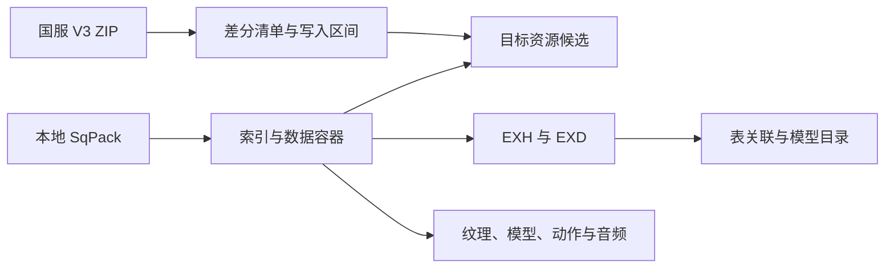

# FF14 解包知识库

从国服 V3 补丁清单追到 SqPack 资源，再读出 Excel、图片、模型、动作和音频。这里记录格式、文件之间的关系，以及用真实客户端复现过的现象。安装和使用说明见[项目 README](../README.md)。

| 想查的问题 | 主题 |
| --- | --- |
| 国服补丁怎么下载，ZIP 里哪些文件对应游戏里的哪些路径？ | [国服 V3 补丁](cn-patches.md) |
| SqPack 索引怎样定位文件，图片和音频 Diff 的候选怎样筛出来？ | [SqPack 与媒体](sqpack-media.md) |
| EXL、EXH、EXD 各保存什么，Raw 快照怎样保留字段和子行？ | [Excel 表格与 Raw 快照](excel.md) |
| 新旧表的数据来自哪里，字段关联和行列差异怎样比较？ | [表格 Diff 与关联](table-diff.md) |
| 如何用中文名字找宠物、坐骑、配饰或 NPC 的模型？ | [模型目录与 NPC 名称](model-catalog.md) |
| MDL 的外观由哪些文件决定，怪物的 Idle 藏在哪里？ | [模型、材质与动作](models-animation.md) |
| 怎样重做一次验证，判断读到了正确的构建、行或资源？ | [复现实验与验证](verification.md) |

## 几个可直接用上的发现

| 发现 | 用处 |
| --- | --- |
| 怪物的 Idle 可从 `resident/monster.pap` 找到。Godbert 优先选 `cbnm_id0`，再尝试 `cbbm_id0`。 | [按动作槽查找 Idle](models-animation.md#怪物-idle-在共享-pap-的槽里) |
| `m6001b0003` 的 `b0003` 指模型的身体部件。SKLB 可以沿共享骨架路径加载。 | [查身体部件和骨架](model-catalog.md#路径中的-b-与骨架) |
| `BNpcBase #5` 的社区名称映射指向 `BNpcName #408`「婴猴」，模型字段指向 `ModelChara #31`。 | [追踪 NPC 名称和模型](model-catalog.md#战斗-npc-名称为什么需要额外映射) |
| EXH 提供原始类型和字节偏移。字段名与引用规则来自配套定义。 | [查询字段名和类型](excel.md#字段名与类型的来源) |

## 验证样本与更新

目前文章中的主要真机样本是国服 7.58，游戏构建号 `2026.11.03.0000.0000`。补丁对比常用 `0.0.0.30 → 0.0.0.31`，对应国服 `7.57 → 7.58`。旧版本或其他语言的验证结果会在各页标明。这里的数量和耗时随构建、机器和缓存变化。

后续发现补进对应主题页。记录复现时使用的构建、数据来源、结果和受影响的判断。有新主题时在首页添加入口。更新约定见[项目协作指南](../AGENTS.md)。
