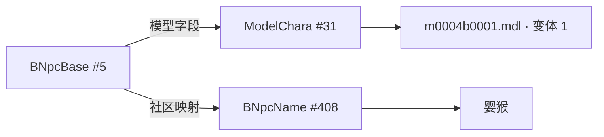

# 从名字找到模型

[知识库首页](README.md)

模型目录可以先读取游戏表，把名称、模型编号和资源路径连起来，再用 SqPack 索引确认文件存在。这样能快速列出可选择的条目，选中后才读取 MDL、IMC 和材质。

本页记录截至 2026-11-13 的实现与实测。目录验证使用国服简中构建 `2026.11.03.0000.0000`。字段解释按该版本核对，程序还会检查每张 EXH 的全部物理列编号、类型和偏移的 SHA-256 签名。其他构建需要重新核对布局。

## 名称与模型分属哪些表

| 表 | 作用 | 当前关联方式 |
| --- | --- | --- |
| `ModelChara` | 保存模型类型、模型编号、身体编号和变体 | 作为资源路径生成的中心 |
| `Companion` | 跟随玩家的小宠物 | 名称和 `ModelChara` 引用直接来自本地表 |
| `Pet` | 召唤兽名称 | 表内没有 `ModelChara` 外键，使用 TexTools 已核实的模型与身体组合，再取本地名称 |
| `Mount` | 坐骑 | 名称和模型引用直接关联 |
| `Ornament` | 阳伞等时尚配饰 | 名称和模型引用直接关联 |
| `BNpcBase` | 战斗 NPC 的基础数据和模型引用 | 模型直接关联，名字另查社区映射 |
| `BNpcName` | 战斗 NPC 名称文本 | 通过可靠的名称行号取本地简中名称 |
| `ENpcBase` | 事件 NPC 的模型和外观数据 | 对可构造单个资源路径的类型生成目录项 |
| `ENpcResident` | 事件 NPC 名称 | 与 `ENpcBase` 按同行 ID 关联 |

实现入口是 [LocalGameSource.NamedModels.cs](../src/FFXIVPatchParser/LocalGameSource.NamedModels.cs)。每条结果同时保存来源表、来源行、`ModelChara` 行、名称来源和可用的名称行号，便于从预览回到表格核实。

当前目录生成类型 3 的 monster、类型 2 的 demihuman 和类型 4 的 weapon 路径。亚人可能按装备部位展开成多条。人形 NPC 需要组合外观和装备，当前目录尚未完成这套装配。未被已知来源引用的可用模型会归入“其他模型”。

## 三个能沿表格复查的例子

| 名称 | 来源链 | 模型路径 |
| --- | --- | --- |
| 婴猴 | `BNpcBase #5` → `ModelChara #31`，社区映射指向 `BNpcName #408` | `chara/monster/m0004/obj/body/b0001/model/m0004b0001.mdl` |
| 典雅方格阳伞 | `Ornament #8` → `ModelChara #3012`，模型 6001、身体 3、变体 3 | `chara/monster/m6001/obj/body/b0003/model/m6001b0003.mdl` |
| USA蹦 | `Companion #212` 与 `ENpcBase #1017486` 均指向 `ModelChara #1402` | `chara/monster/m8168/obj/body/b0001/model/m8168b0001.mdl` |

USA蹦同时出现在宠物和事件 NPC 分类，说明一个模型可以承担多个游戏用途。阳伞放在 `monster` 资源族中，也说明资源族描述的是游戏内部组织方式，目录分类应以来源表为准。

国服简中构建 `2026.11.03.0000.0000` 的表数据可用以下方法复核。将上表各来源的模型引用与 `ModelChara` 行号连接，筛选模型类型 3，再按模型编号的千位统计来源行数。同一模型可以被多行引用。589 条跟随宠物（`Companion`）记录全部落在 m8xxx，56 条时尚配饰（`Ornament`）记录全部落在 m6xxx。m8xxx 另有 628 条战斗 NPC、926 条事件 NPC 记录。m7xxx 有 131 条战斗 NPC、54 条事件 NPC 和 1 条坐骑记录。m6xxx 也有 1 条事件 NPC 记录。因此目录保留同一模型的各个来源；按编号浏览时，只有与 `Pet` 已核实的模型及身体组合才能显示对应召唤兽名称。[国服表快照](https://github.com/InfSein/ffxiv-datamining-mixed/tree/9e2c05c0ed8205d5397031152f62a34900355de4)

### 路径中的 b 与骨架

`obj/body/b0003` 中的 `b0003` 是身体或基础模型编号。实际骨架是另一份 `.sklb` 文件，位于 `skeleton/base/...`。当前怪物动作实现读取 `skeleton/base/b0001/skl_mXXXXb0001.sklb`，支持范围和检查见[模型与动作](models-animation.md)。

验证骨架时先查 SKLB 文件，再用其中的骨骼名称与模型引用的名称对照。

### ModelChara 变体如何落到材质

`ModelChara.Variant` 先选择 IMC 子集，再由该部位的 `MaterialId` 决定 `material/vXXXX`。变体为 0 时取默认项，正数变体按 `Variant - 1` 读取变体数组。亚人还需要根据装备部位和 `PartMask` 找到相应条目。

典雅方格阳伞实测从 IMC 子集 3 得到材质编号 3。缺失部位、越界子集和材质编号 0 会报错。找不到 IMC 文件时，预览用 `max(1, Variant)` 作为材质编号。 [IMC 变体解析](../src/FFXIVPatchParser/LocalGameSource.NamedModels.Materials.cs)

## 战斗 NPC 名称为什么需要额外映射

从战斗 NPC 的基础行可以直接读出 `ModelChara` 引用。名称要先通过社区映射找到 `BNpcName` 的行号，再从对应构建的表读取文字。婴猴的两条链路如下。

项目使用固定版本的 Anamnesis 名称映射，并验证 Git blob 哈希。`B:0000005` 这样的键标识战斗 NPC 基础行。右侧值决定去哪里读取名称。Anamnesis 的贡献指南介绍了在游戏中选中 NPC、用工具查找名称行号，再提交到 `NpcNames.json` 的流程。 [Anamnesis 贡献指南](https://github.com/imchillin/Anamnesis/wiki/Notes-for-Community-Developers#finding-npc-names-from-their-appearances) · [NpcNames.json](https://github.com/imchillin/Anamnesis/blob/e180a0f124cb45db5bf56b283b41b8920a7e4c2e/Anamnesis/Data/NpcNames.json)

「补充 NPC 名称」优先读取本地缓存的固定版本 `NpcNames.json`。缓存缺失或无效时才重新下载。能取得 `BNpcName` 行号时，用当前游戏的简中名称。只有英文名时，尝试从 FFCafé 更新中文对照，失败后复用已有对照或读取 InfSein 的英中历史 CSV，最后重建模型目录。 [名称读取和回退](../src/FFXIVPatchParser/NpcNameHints.cs) · [重建目录入口](../src/FFXIVPatchParser.Desktop/ModelPreview.Catalog.cs)

| 值的形式 | 处理方式 | 能保留的证据 |
| --- | --- | --- |
| `N:0000408` | 读取本地 `BNpcName #408` | 名称行号与本地简中原文 |
| `E:...` | 读取本地 `ENpcResident` 对应行 | 事件名称行号与本地原文 |
| 字面英文名称 | 保留社区名称，可追加经核对的中文翻译 | 社区别名来源，通常没有本地名称行号 |

字面英文翻译先查 [FFCafé 字符串数据库](https://strings-legacy.ffcafe.cn/) 的 `BNpcName.csv`。英文首行经过去空白和小写处理后精确匹配，只有所有命中的中文结果非空且唯一时才接受。网络查询失败时，优先复用已有翻译缓存，再使用固定版本的 InfSein `en` 与 `chs` 表按行号对照。具体下载、校验和唯一性筛选见 [NpcNameHints.cs](../src/FFXIVPatchParser/NpcNameHints.cs)。

字面别名及其翻译用于显示。需要按行跳转到 `BNpcName` 时，用有 `N:` 行号的映射。详情中的字面名称来源统一标为「Anamnesis 手工名字」，FFCafé 或 InfSein 翻译来源尚未逐条显示。

### 从 BossMod 主目标补充战斗 NPC 名称

BossMod 从游戏对象的 `BaseId` 读取战斗模块所用的 OID。模块未显式指定主目标时，注册器使用 `OID.Boss`。模块浏览器用 `GroupType.CFC` 模块的 `NameID` 查询 `BNpcName`，副本名称则来自 `ContentFinderCondition`。其他 GroupType 的 `NameID` 可能指向别的表。模块中的小怪、机制道具和共享模型需要独立证据。 [运行时对象](https://github.com/awgil/ffxiv_bossmod/blob/ee5b04a4ab63fb4313d29dbbb671f029f74752b7/BossMod/Framework/WorldStateGameSync.cs#L394) · [主目标注册](https://github.com/awgil/ffxiv_bossmod/blob/ee5b04a4ab63fb4313d29dbbb671f029f74752b7/BossMod/BossModule/BossModuleRegistry.cs#L86) · [副本、主目标名称](https://github.com/awgil/ffxiv_bossmod/blob/ee5b04a4ab63fb4313d29dbbb671f029f74752b7/BossMod/Config/ModuleViewer.cs#L417)

2026-11-16 对照 BossMod `ee5b04a` 和国服简中 `2026.11.03.0000.0000`。以下八个主目标在本地同时有副本、名称和可定位的模型，用于补充原有名称映射的空缺。复现时先从模块记下 `GroupID`、`NameID` 和 `OID.Boss`，再在本地查看对应的副本、名称和 `BNpcBase` 模型列，按 `ModelChara` 定位模型。两个林德布鲁姆同名，各自保留名称行和模型。

| BNpcBase | BNpcName | 本地简中 | ContentFinderCondition | ModelChara | BossMod 模块 |
| ---: | ---: | --- | ---: | ---: | --- |
| 16661 | 12854 | 艳翼蛇鸟 | 832 | 3999 | `T01Valigarmanda` |
| 17065 | 12881 | 佐拉加 | 995 | 3605 | `T02Everkeep` |
| 16832 | 13029 | 永恒女王 | 984 | 4036 | `T03QueenEternal` |
| 18371 | 13861 | 泽莲尼娅 | 1030 | 4411 | `T04Zelenia` |
| 18544 | 14093 | 永远之暗 | 1061 | 4497 | `T05Necron` |
| 18992 | 14284 | 格莱杨拉波尔 | 1076 | 4656 | `T07Doomtrain` |
| 19195 | 14378 | 林德布鲁姆 | 1075 | 4658 | `RM12S1TheLindwurm` |
| 19202 | 14379 | 林德布鲁姆 | 1075 | 4659 | `RM12S2TheLindwurm` |

实现使用已核对的八组 ID，界面可以跳到本地名称行与模型行。 [试炼模块](https://github.com/awgil/ffxiv_bossmod/tree/ee5b04a4ab63fb4313d29dbbb671f029f74752b7/BossMod.Modules/Dawntrail/Trial) · [零式模块](https://github.com/awgil/ffxiv_bossmod/tree/ee5b04a4ab63fb4313d29dbbb671f029f74752b7/BossMod.Modules/Dawntrail/Savage) · [目录实现](../src/FFXIVPatchParser/LocalGameSource.NamedModels.cs)

### InfSein 对照实际覆盖多少

研究固定在提交 [`9e2c05c`](https://github.com/InfSein/ffxiv-datamining-mixed/tree/9e2c05c0ed8205d5397031152f62a34900355de4)。该快照中的 `en`、`ja`、`chs` 三份 `BNpcName` 均为 15,001 行，文件通过 Git blob 校验。英文和日文表最后更新标记为 GLOBAL 7.56，简中为 CHS 7.58，三者属于同一仓库快照，但客户端版本不同。

固定版本的 Anamnesis 数据有 1,125 条字面名称映射，去重后剩 1,088 个名称。按英文精确匹配并得到唯一简中结果的有 28 个，覆盖 31 条映射，例如 `raptor` 对应「盗龙」。其余 1,060 个名称没有英文精确命中。作为交叉检查，28 个结果中有 27 个同时取得唯一非空的日文文本。

## 快速目录与深度扫描各在做什么

Godbert 从 `ModelChara` 筛出类型 3，按路径规则检查 IMC 和 MDL 是否存在，再组成模型、身体、变体层级。TexTools 把项目和依赖写入 SQLite 缓存，游戏版本或语言变化后可以重建。 [Godbert 怪物视图](https://github.com/xivapi/SaintCoinach/blob/master/Godbert/ViewModels/MonstersViewModel.cs) · [TexTools XivCache](https://github.com/TexTools/xivModdingFramework/blob/master/xivModdingFramework/Cache/XivCache.cs)

本项目的快速目录同样采用“读表 → 生成候选 → 索引确认”，结果保存在当前 `LocalGameSource` 实例中。召唤兽身份参考 [TexTools Companions](https://github.com/TexTools/xivModdingFramework/blob/master/xivModdingFramework/Items/Categories/Companions.cs)。[深度扫描实现](../src/FFXIVPatchParser/LocalGameSource.ModelCatalog.cs) 另行遍历容器中的资源地址并检查模型，可用于发现表目录覆盖之外的资源。

2026-11-13 的目录验证按来源统计条目数。

| 分类 | 条目数 |
| --- | ---: |
| 事件 NPC | 20,329 |
| 战斗 NPC | 16,913 |
| 宠物 | 589 |
| 坐骑 | 484 |
| 其他模型 | 256 |
| 时尚配饰 | 56 |
| 召唤兽 | 19 |
| 合计 | 38,646 |

38,646 的计数单位是目录条目。同一 MDL 可以被不同来源行、不同分类或变体重复引用，因此它衡量可浏览的关联记录数量。资源文件去重数、完整游戏模型数和有可靠名字的条目数需要分别统计。

该次首次调用约 0.612 秒，同实例再次调用约 0.000819 秒。计时从 `LocalGameSource` 构造完成后开始。这里的“首次”表示尚未生成实例内目录，操作系统文件缓存状态未控制，也未包含程序启动和预览加载时间。

## 复查与继续扩展

1. 记录客户端构建和语言，调用 `ListNamedModelsAsync`，保存分类计数与来源链摘要。
2. 检查三个示例的来源行、模型行、资源存在性，再单独调用 `ResolveNamedModelMaterialVariant`。
3. 对同一个实例重复调用，分别记录首次生成与命中缓存的耗时。需要比较物理文件数量时，另外按 `Path` 去重。
4. 扩展名称映射时保留基础行、名称行、数据版本和翻译来源。扩展人形 NPC 时增加外观与装备装配验证。

### 对照 Anamnesis 的角色外观选择

Anamnesis 按部族与性别从 `CharaMakeCustomize` 组织发型选项。选项包含预览图标、关联道具及脸型字段。其游戏外观 `.dat` 读取逻辑用脸型检查硌狮族发型的兼容性。离线目录可先按当前体型展示可用资源，再以表字段补充图标与脸型筛选。部族和脸型筛选仍需核对本地表布局及模型路径。 [发型选项](https://github.com/imchillin/Anamnesis/blob/243411ba43eec07868ce23fbcfa730f3e71c75a8/Anamnesis/GameData/Sheets/CustomizeSheet.cs) · [外观字段](https://github.com/imchillin/Anamnesis/blob/243411ba43eec07868ce23fbcfa730f3e71c75a8/Anamnesis/GameData/Excel/CharaMakeCustomize.cs) · [游戏外观文件](https://github.com/imchillin/Anamnesis/blob/243411ba43eec07868ce23fbcfa730f3e71c75a8/Anamnesis/Files/DatCharacterFile.cs)

装备选择器按部位、职业及装备类别筛选，可以搜索物品行号、模型编号和变体。角色页分别处理主副手、防具、首饰及染色，角色文件还支持按外观、装备和武器分别载入。离线预览可用本地物品名和已验证模型路径做装备选择，再验证首饰装配、染色和外观预设导入。Anamnesis 的 GPose 演员管理、物品拥有状态和实时模型着色器参数依赖运行中的客户端。 [装备选择器](https://github.com/imchillin/Anamnesis/blob/243411ba43eec07868ce23fbcfa730f3e71c75a8/Anamnesis/Actor/Views/EquipmentSelector.xaml.cs) · [角色页](https://github.com/imchillin/Anamnesis/wiki/The-Character-Tab) · [角色文件](https://github.com/imchillin/Anamnesis/wiki/Loading-and-Saving-Character-Files)

### 角色外观槽与图标

在国服简中 `2026.11.03.0000.0000`，`ui/uld/character.uld` 的 PartList 12 引用 `ui/uld/Character.tex`。切片 17 至 28 是 32 × 32 的装备空槽图案，切片 22 是旧腰带槽，两枚戒指使用同一切片。`characterinspect.uld` 的左右列位置分别为 X=0 和 X=262，行距为 46。角色外观浮窗沿用两列部位关系，图案保留原透明遮罩，底色使用软件主题。

`ui/uld/ActionBar.uld` 的组件 1001 中，节点 18 引用 PartList 3 的第 0 项，裁切 `IconA_Frame.tex` 的 `(0, 0, 48, 48)`。节点 20 的图标相对组件根节点位于 `(2, 3)`，外框的父节点相对组件根节点左移 2 像素。因此浮窗以外框为原点，在 `(4, 3)` 绘制 40 × 40 的装备图标与空槽位图案。 [图标和外框读取](../src/FFXIVPatchParser/LocalGameSource.CharacterPartIcons.cs) · [槽位摆放](../src/FFXIVPatchParser.Desktop/ModelPreview.CharacterParts.cs)

`Item` 的列 10 是图标，列 47、48 是主模型与副模型。武器打包值的前三个 `UInt16` 分别取武器编号、Body 编号和 IMC 子集。防具候选以同体型的实存模型为主，左右戒指使用各自的模型槽。 [Item 定义](../src/FFXIVPatchParser/Definitions/Item.json) · [装备候选读取](../src/FFXIVPatchParser/LocalGameSource.CharacterPartOptions.cs)

#### 首饰来源与体型变形

Anamnesis 从游戏 `Item` 表和附加装备目录取候选，再按部位、职业、类别及可选的种族与性别限制过滤。选择器不会要求物品具备当前体型编号的 MDL。幻化柜的离线首饰渲染从当前体型沿 PBD 父体型查询 accessory EQDP，用对应部位的模型存在位选择 MDL，再读原材质、IMC 和蒙皮权重。 [Anamnesis 装备选择器](https://github.com/imchillin/Anamnesis/blob/243411ba43eec07868ce23fbcfa730f3e71c75a8/Anamnesis/Actor/Views/EquipmentSelector.xaml.cs#L180-L286) · [幻化柜首饰加载](https://gitee.com/kilislan-wei/ffxiv_offline_glamour/blob/a97d546bf401808f5044b4ee068707cb58593c16/character/accessories.py)

国服简中 `2026.11.03.0000.0000`，拉拉菲尔女 `c1201` 的目录以有 `Item` 行号的候选计，耳饰 1,317 项、项链 1,249 项、手镯 1,245 项、左右戒指各 1,294 项。耳饰 `#1521` 取 `c1101a0001_ear`，项链 `#1540`、手镯 `#1557` 和两枚 `#1581` 戒指取 `c0101` 模型。模型与材质可以由不同体型共用。样本合装后在 `battle08.pap` 的第 0、60 帧之间五个槽位均有顶点位移。 [首饰选源](../src/FFXIVPatchParser/LocalGameSource.AccessoryModels.cs) · [PBD 变形](../src/FFXIVPatchParser/LocalGameSource.BodyDeformation.cs) · [Meddle PBD 格式](https://github.com/PassiveModding/Meddle/blob/7cd06e846e726bbd200f856a663eadb0245312c8/Meddle/Meddle.Formats/Files/PbdFile.cs)

`HairMakeType` 的列 0 至 2 是种族、部族、性别，列 30 是发型数，列 `66 + 9 × i` 引用 `CharaMakeCustomize`。后者列 0 的 FeatureID 对应 `h####`，列 1 给出图标。三项实测 `h0001` 分别为 `c0101` 的图标 `131001`、`c0801` 的 `134201`、`c1201` 的 `133201`，均找到 192 × 192 的 `_hr1.tex`。 [本地发型表定义](../src/FFXIVPatchParser/Definitions/HairMakeType.json) · [Glamourer 发型表读取](https://github.com/Ottermandias/Glamourer/blob/e165910345b17b99d9aa35990005b5e0f73ae65b/Glamourer/GameData/CustomizeSetFactory.cs#L125-L150)

### 幻化柜参考

幻化柜用 PySide6 和 Direct3D 11 实现离线试衣。公开客户端源码采用 MIT 许可，完整构建依赖未随仓库公开的工具、装备目录数据和原生组件。它的同模分组可应用于现有物品目录，保留每个物品的 IMC 变体、染色通道与光效编号，便于对照同一网格的款式。DAT 外观、装备模板和渲染状态分离的设计也适合离线预览。DAT 导入可以先校验构建及体型，预览使用内存副本；双染色应按 IMC 和 MTRL 的通道与模板核对。 [项目说明与许可](https://gitee.com/kilislan-wei/ffxiv_offline_glamour/blob/a97d546bf401808f5044b4ee068707cb58593c16/README.md) · [武器光效核对](sqpack-media.md#武器光效的-imc-入口与挂点)

#### 排序和筛选

| 视图 | 固定提交中的行为 |
| --- | --- |
| 防具和首饰平铺 | 启用本地库时收藏优先，其次放配置的部位示例，剩余按物品 ID 降序。 |
| 防具和首饰同模目录 | 按当前部位和主模型低 16 位分组。同组代表优先选择染色区多的款式，再按物品 ID 降序。过滤时只从命中款式选代表，目录数量仍显示整组规模。 |
| 战斗武器 | 可按武器分类筛选。同模组同时考虑主模型和副模型低 32 位，避免主模型相同而副手组合不同的装备混到一起。组代表优先染色区，再按 ID；目录列表按代表的 ID 降序。 |

搜索支持名称包含、物品 ID 精确匹配、穿戴等级区间和可组合标签。空格分开的条件需同时命中，`#标签`、`标签:` 或 `tag:` 只查标签。染色区数、原生 IMC 光效、以及有数据支撑的获取来源可成为标签；第三方资料中未核实的装备来源不应直接写入本地目录。同套装会先取已有关系，缺数据时把按名称、模型、职业、等级推导的结果标为候选。 [同模与排序](https://gitee.com/kilislan-wei/ffxiv_offline_glamour/blob/a97d546bf401808f5044b4ee068707cb58593c16/catalog/catalogue.py) · [筛选、收藏和套装候选](https://gitee.com/kilislan-wei/ffxiv_offline_glamour/blob/a97d546bf401808f5044b4ee068707cb58593c16/catalog/equipment_library.py) · [武器目录](https://gitee.com/kilislan-wei/ffxiv_offline_glamour/blob/a97d546bf401808f5044b4ee068707cb58593c16/ui/qt_weapons.py)

#### 装备渲染差异

幻化柜用 EQDP 的部位存在位和 PBD 的父体型关系选取源 MDL，校验该源的 IMC 材质资源，并在换体型时变形。头、身装备的独立骨骼从 `extra_met.est`、`extra_top.est` 解析并接到角色骨架。可见性调用接收槽位、标志、掩码和种族，具体规则依赖完整工程的 `preset_outfit`。本项目按体型继承选取首饰和防具，已验证下文的整套模型组装。多件衣物之间的遮盖仍待验证。 [幻化柜装备实现](https://gitee.com/kilislan-wei/ffxiv_offline_glamour/blob/a97d546bf401808f5044b4ee068707cb58593c16/character/equipment.py) · [本项目 MDL 读取](../src/FFXIVPatchParser/LocalGameSource.Models.cs)

国服简中 `2026.11.03.0000.0000` 中，`c0101e0002_met.mdl` 的 IMC 子集 1 与 50 同用材质 1，显隐位分别为 `0x3FC` 和 `0x3FF`。LOD 0 的 `atr_mv_a` 与 `atr_mv_b` 对应 294、2070 个索引，合计 788 个三角面。本项目在同一模型上实测，子集 1 提交 696 个索引（232 面），子集 50 提交 3060 个索引（1020 面）。直接打开 MDL 时保留全部 3060 个索引。复核时读取对应 IMC 条目的低十位，再按 MDL 的属性名称定位子网格的索引范围。角色装备按部位识别变体属性，位为 0 时隐藏相应索引；饰品只应用 A 位。[IMC 读取](../src/FFXIVPatchParser/LocalGameSource.NamedModels.Materials.cs) · [子网格筛选](../src/FFXIVPatchParser/LocalGameSource.Models.cs) · [Penumbra IMC 编辑说明](https://github.com/xivdev/Penumbra/wiki/Advanced-Editing#variant-edits-imc) · [部位属性对照](https://xivmodding.com/books/ff14-asset-reference-document/page/attribute-reference-tables)

## 从容器地址恢复路径与 Diff 扫描

在国服简中构建 `2026.11.03.0000.0000` 上，模型扫描先检查索引地址的资源类型，再用仓库、资源类别和 64 位索引哈希匹配已知路径。命中后还要确认本地安装中存在该路径。索引只存哈希，查不到路径或匹配到多个候选时保留 `sqpack:容器@偏移#哈希`。角色或物件的中文名称需另查来源表。 [模型扫描](../src/FFXIVPatchParser/LocalGameSource.ModelCatalog.cs) · [路径目录](../src/FFXIVPatchParser/LocalGameSource.ModelPaths.cs)

路径来源包括已加载的本地命名模型目录、通过 EXH 签名检查的 `ModelChara` 候选、常见角色和装备路径，以及用户导入的 UTF-8 文本目录。文本格式为每行一个游戏内 `.mdl` 路径。展开「扫描选项」，点击「导入已知模型路径」，导入后自动进入「按资源类型」查看匹配结果。导入会与 `tmp/model-paths/catalog.txt` 合并去重，清除当前实例的完整模型扫描缓存。其他已打开的游戏源实例需要重新打开才会读取新目录。路径列表不包含模型内容。

### 场景样例实测

研究使用 [FFXIV Explorer 的 hashlist.7z](https://github.com/goaaats/ffxiv-explorer-fork/blob/9f4f4f9a69c6d6aa53a89b3069d1b5f883d8afdb/hashlist.7z)。下载归档的 SHA-256 为 `61484431EB0A667756344745AB33EF8B6F383D993AF9A297C40E4F1C2D9E0115`。从 SQLite 的 `fullpaths`、`folders`、`filenames` 表导出并去重得到 163,763 条 `.mdl` 候选。这是该字典样本的数量，不代表当前游戏全部模型。

该来源仓库的许可证 API 未提供可识别的许可证，字典也未核实独立再分发授权。因此数据库、解压文件和导出列表只用于 `tmp/` 本地研究，不随程序或知识库分发。工具提供用户导入入口，不自动下载或打包该字典。

| 索引定位 | 实测恢复路径 | 本地预览 |
| --- | --- | --- |
| `sqpack:ex1/020102.win32.dat0@103B4700#E520DF11FCBE63EB` | `bg/ex1/02_dra_d2/dun/d2d6/bgplate/0048.mdl` | 3 个网格、3 个材质 |

该容器全扫得到 5,687 个模型，字典恢复其中 5,526 条路径。剩余 161 条继续保留原始地址。常见角色路径推导无法覆盖场景目录，外部字典的覆盖程度也随游戏版本和采集范围变化。

### 性能范围与校验边界

[补丁模型扫描](../src/FFXIVPatchParser/PatchImageScanner.cs)先求写入区间与索引存储区间的交集，再读取候选 DAT 文件头。它仍使用相邻索引地址确定存储区间，保留对齐填充。按范围扫描不会写入完整容器缓存，随后全扫仍能取得全部条目。角色路径枚举改用索引哈希集合，并先排除不存在的装备目录，避免为约百万候选逐一查询文件是否存在。

单容器测试在 `LocalGameSource` 构造完成后计时。测试沿用系统的文件缓存。

| 样本与阶段 | 优化前 | 最终实现 |
| --- | ---: | ---: |
| `ffxiv/040000.win32.dat0` 首次模型目录 | 11.689 秒，14,969 条，12,224 条已知路径 | 2.879 秒，14,969 条，13,545 条已知路径（含外部目录与 ModelChara 补全） |
| `ex1/020102.win32.dat0` 新实例全扫 | 未测 | 1.251 秒，5,687 条 |
| 同场景容器，新实例仅上述模型的存储区间 | 未测 | 0.934 秒，1 条，与全扫取交集一致 |
| 范围扫描后同实例全扫 | 未测 | 0.183 秒，仍为 5,687 条 |

上述场景测试另有 7.294 秒的游戏源初始化耗时。已验证取消请求生效，已知路径与未知地址都能读取模型。

另测 `0.0.0.30 → 0.0.0.31` 全部模型相关容器。从游戏源初始化完成后计时，共 125.68 秒，筛出 8 个写入候选。校验目标文件和分析差分合计 123.88 秒，之后的索引筛选约 1.80 秒。抽查的场景模型 `w_xma_009_03a.mdl` 和装备模型 `c0201e0167_sho.mdl` 均能预览。选择单个容器时只校验该容器和对应索引，可缩短等待。 [SqPack 与媒体资源](sqpack-media.md)

## 已知路径目录与未知模型扫描

本地模型页的「按资源类型」吸收原有来源目录。「按模型编号」保留按模型号、部件、变体浏览的结构。资源类型中的武器、防具与饰品按 Item 行号排列，缺少 Item 关联的模型放在各自的「未关联物品」中。怪物和亚人按用途细分，同一资源的不同表引用分别保留。已知名字直接显示在列表里。缺少表用途的怪物可按 m6xxx、m7xxx、m8xxx 归入时尚配饰、召唤兽、宠物，名称仍采用可核对的编号。导入或扫描路径后回到资源类型目录，扫描角色容器时保留现有家具和场景条目。

国服简中构建 `2026.11.03.0000.0000` 的已知 MDL 路径共 186,862 条。按目录统计，`chara` 42,053、`bg` 133,742、`bgcommon/hou` 5,735、其余 `bgcommon` 5,332。资源类型中的条目数可以高于路径数，因为一个 MDL 可被多条物品或 NPC 记录引用。WPF 离屏验证从资源类型按「强腕的居格斯」搜索，点击 `ENpcBase #1004867` 后加载 3 个网格；编号页仍可按 `d1009` 查看单件和已有名称的变体。[资源目录](../src/FFXIVPatchParser.Desktop/ModelPreview.Catalog.cs)

预览取景使用当前网格计算出的模型包围盒。模型镜头允许自由穿过包围盒，近平面取 0.0002 至 0.01 个世界单位。模型动画可以伸出绑定姿势的包围盒，远平面也留有余量。实测中原之民组合可沿视线飞过旧的包围盒边界。 [模型取景](../src/FFXIVPatchParser.Desktop/ModelPreview.xaml.cs) · [镜头投影](../src/FFXIVPatchParser.Desktop/PreviewCameraController.cs)

需要查找未识别路径时，可在「扫描选项」中点「扫描未知模型」；默认扫描角色容器，勾选「包含场景等模型」后扩展范围。此操作仍会逐项读取资源头，耗时取决于容器规模。 [目录交互](../src/FFXIVPatchParser.Desktop/ModelPreview.Catalog.cs) · [已知媒体索引](../src/FFXIVPatchParser/LocalGameSource.LocalMediaCatalog.cs)

## 从游戏存档还原外观和套装

国服简中构建 `2026.11.03.0000.0000`，以一份角色创建外观和一份角色套装配置只读验证。外观存档 `FFXIV_CHARA_*.dat` 长 212 字节，文件头为小端 `0x2013FF14`、版本 5。从偏移 16 取 32 字节，对第 i 字节左移 `i % 24` 位后异或，所得 32 位值与偏移 8 的校验值一致。预览使用种族、性别、部族、脸型、发型、肤色、发色、挑染和一侧瞳色。脸型由部族的 CharaMakeType 菜单选项映射到实际模型。[外观读取实现](../src/FFXIVPatchParser/CharacterAppearancePreset.cs) · [Anamnesis 外观存档说明](https://github.com/imchillin/Anamnesis/wiki/Loading-and-Saving-Character-Files)

`GEARSET.DAT` 的本次样本长 45689 字节，头部前两项为 5、110，两个长度字段均等于文件长度减 32。偏移 16 起的字节与 `0x73` 异或后，偏移 21 起连续 100 条记录，每条 452 字节。逐条比对记录编号与槽序号，100 条全部一致。套装存在标志、幻化模板关联号、14 个装备记录的槽序、装备与投影物品编号、两道染色都可与上游字段布局核对。桌面导入时选择角色目录里的配置文件，再选择具体套装，使用投影物品优先匹配 Item 模型。配置提供已保存套装的外观快照与关联模板编号，完整模板内容仍缺少可离线验证的本地来源。[套装读取实现](../src/FFXIVPatchParser/SavedGearset.cs) · [FFXIVClientStructs 装备记录定义](https://github.com/aers/FFXIVClientStructs/blob/main/FFXIVClientStructs/FFXIV/Client/UI/Misc/RaptureGearsetModule.cs)

护甲与首饰分别查各自的 EQDP 部位位，再沿 PBD 的父体型查找实际 MDL。样本有 36 套已保存的配装。使用已配置的动作解码库组装其中一套时，11 个已装备部位全部匹配，脸型也与存档所选模型一致。

## 装备物品与模型编号

国服简中构建 `2026.11.03.0000.0000` 实测，按资源类型浏览时，武器、防具和饰品分别有 8,788、15,414 和 5,105 条具名 Item 记录能匹配本地模型。每种物品按 Item.RowId 列一次，多个物品可以共用 MDL。Item 第 17 列决定装备部位，第 47、48 列分别提供主模型和附加模型。武器从低到高的三个 16 位字段依次给出武器编号、躯体编号和 IMC 子集，防具及饰品使用前两个字段作为模型编号和 IMC 子集。独立展示优先选取存在的体型模型，材质和可见网格使用所选部位的 IMC 记录。

复核时按物品编号选中 #100、#366、#1521，分别读到武器材质 4、头部材质 47、耳饰材质 2。#124 的主副手为 `w0301b0009` 与 `w0351b0009`，材质均为 2。这五次模型读取均得到一个网格和一个材质。逐个核对目录内不同的模型路径与子集组合，有三个武器组合的 IMC 材质编号为 0，客户端指定隐藏该模型部位。

按模型编号浏览时，Item 补充模型路径，ModelChara 保留原有变体记录。本机已识别路径清单在物品路径补充前，武器、防具、饰品、亚人、怪物、角色部件分别有 990、1,623、190、93、1,562、27 个一级编号。角色部件用 c 编号再按部件细分。场景、家具与过场沿用资源路径层级。已识别路径数量随导入的名称库变化。[装备路径与部位解析](../src/FFXIVPatchParser/LocalGameSource.CharacterPartOptions.cs) · [模型目录](../src/FFXIVPatchParser.Desktop/ModelPreview.Catalog.cs)

### 装备染色区与材质模板

国服 7.58 简体中文构建 `2026.11.03.0000.0000` 的 Item 第 28 列为 UInt8，偏移 156。逐行读取的 52,801 条记录中，39,297 条为 0，7,336 条为 1，6,168 条为 2。外观页按物品行的区数提供染色入口。Stain 第 0 列是列表色块 RGB，第 5、6 列是名称文本，行 0 可恢复原色。组件 `ui/uld/ActionBar.uld` 1001 的节点 5 引用 PartList 3 的第 30 项，对应 `IconA_Frame.tex` 的 18 × 18 加号切片，左上角为 (396, 114)。[物品字段](../src/FFXIVPatchParser/Definitions/Item.json) · [染色剂字段](../src/FFXIVPatchParser/Definitions/Stain.json) · [角色图标](../src/FFXIVPatchParser/LocalGameSource.CharacterPartIcons.cs)

本构建的 32 行材质色表之后可接 32 个四字节染色标记。位 27–28 指定从零计数的通道，位 16–26 指定模板，位 0 控制漫反射。预览按实际模板键从 `stainingtemplate.stm` 或 `stainingtemplate_gud.stm` 读取对应染色剂的线性 RGB，再复用材质的索引贴图生成基色。两个 STM 在此构建各有 43 个模板，键互不重叠。预览尚未计算染色模板对高光、发光与粗糙度的影响。[本项目材质读取](../src/FFXIVPatchParser/LocalGameSource.EquipmentStains.cs) · [Penumbra 染色行字段](https://github.com/Ottermandias/Penumbra.GameData/blob/27398d969459cdda7361b1b8c6c797b2a7188e2a/Files/Materials/ColorDyeTableRow.cs) · [STM 列编码](https://github.com/Ottermandias/Penumbra.GameData/blob/27398d969459cdda7361b1b8c6c797b2a7188e2a/Files/StmFile.StainingTemplateEntry.cs)

在 c0101 角色上装备样本，依次设置（原色、原色）、（素雪白、原色）、（原色、罗兰莓）、（素雪白、罗兰莓），最后两区恢复原色。读取拼装后主材质的 BGRA 像素，单染武器「北极星刺·优雅」#41679 得到两种摘要，单独改变第二区保持原图；双染身体装备「零点铠甲」#52656 得到四种摘要。两件装备恢复原色后都与初始像素一致。WPF 控件回归另外核对了第二区菜单的 126 个选项（含原色），选择罗兰莓后第一区仍为 0。独立物品预览也使用同一菜单；控件测试确认选色后替换材质，继续使用原来的模型场景。[角色装配](../src/FFXIVPatchParser/LocalGameSource.CharacterPreview.cs) · [染色菜单](../src/FFXIVPatchParser.Desktop/ModelPreview.EquipmentStains.cs)

## 幻化模板导入

「角色预览」的种族、NPC、装备栏和配色集中在左侧。页内的「导入模板码」支持幻化柜 HGG1、HGG2、HGG3 模板码与 `HGG-templates` 批量导出文件。模板码使用 Base64URL 编码的 UTF-8 JSON，并以原始字节的 SHA-256 前 16 个十六进制字符校验。导入时核对版本、区服、槽位顺序及物品和染色范围，空装备位恢复该部位默认外观。HGG3 可读主副手，HGG2/3 可识别面饰字段，面饰尚未渲染。用三条构造样本及其批量文件与上游解码结果对照。[幻化柜模板编码](https://gitee.com/kilislan-wei/ffxiv_offline_glamour/blob/a97d546bf401808f5044b4ee068707cb58593c16/storage/template_code.py) · [模板读取实现](../src/FFXIVPatchParser/OutfitTemplate.cs)

同一入口支持 Glamourer V1 临时设计与 V3 保存设计 JSON 的人形装备字段。用构造样本验证了分别应用物品、双染色和保留原部位三种状态，并使用本地 SqPack 生成角色模型。插件的自定义模型、特殊空槽编号、面部定制、隐藏帽子等设置未纳入此入口。[Glamourer 装备序列化](https://github.com/Ottermandias/Glamourer/blob/e165910345b17b99d9aa35990005b5e0f73ae65b/Glamourer/Designs/DesignBase.cs) · [持久化设计版本](https://github.com/Ottermandias/Glamourer/blob/e165910345b17b99d9aa35990005b5e0f73ae65b/Glamourer/Designs/Design.cs)

### 亚人命名条目的部件组装

国服简中 7.58（2026.11.03.0000.0000）从本地命名目录选取 ModelChara 行，以模型编号与装备编号查询五个装备部位，再逐部位解析 IMC。组装时按骨名合并骨骼索引，并将各部件网格映射到对应材质。

| ModelChara 行 | 模型 / 装备 | 变体 | 本地读取结果 |
| --- | --- | --- | --- |
| 7 | d1005 / e0001 | 1 | top，1 个网格、77 根骨骼 |
| 9、2694、2695 | d1007 / e0001 | 1、5、6 | top，各 1 个网格、76 根骨骼，分别读取 v0001、v0005、v0006 的材质 |
| 1431 | d1027 / e0001 | 1 | met 和 top，共 2 个网格、2 个材质、34 根骨骼 |

d1005 和 d1007 的预览读取到由 MTRL 色表与索引贴图生成的基色。在「按模型编号」展开亚人可打开组合或单件。「按资源类型」优先显示可组装的亚人，带表关联的变体使用 NPC 名称。WPF 离屏验证两种入口均能加载组合模型。 [组装实现](../src/FFXIVPatchParser/LocalGameSource.DemiHumans.cs) · [IMC 部位与属性掩码](../src/FFXIVPatchParser/LocalGameSource.NamedModels.Materials.cs)

### 模型目录重访

两棵模型目录树按标签分别保存展开和选中状态。同一轮目录数据和筛选词下复用已建树。离开角色预览时，先前选中的目录条目会恢复原模型画面。 [目录状态](../src/FFXIVPatchParser.Desktop/PathTreeView.cs) · [树缓存](../src/FFXIVPatchParser.Desktop/ModelPreview.xaml.cs)

### 文件树已命名、模型扫描仍显示地址

国服简体中文构建 `2026.11.03.0000.0000` 上，逐项比较 `EnumerateFileSystemEntries`、`ListKnownLocalMediaLocations("model")` 和 `ListModelLocations`。旧模型扫描单独从模型清单和表格推导名称，导致同一进程里文件树与媒体目录能显示路径，扫描结果仍显示物理地址。模型扫描现在直接复用文件系统按容器缓存的索引条目，未知项继续使用原有模型命名逻辑。同一物理地址有多个不同的已知别名时，扫描结果保留地址。[模型扫描实现](../src/FFXIVPatchParser/LocalGameSource.ModelCatalog.cs)

本次比对 `ffxiv/040000.win32.dat0` 的八个 MDL。两份 SqPack 索引分别验证目录与文件名 CRC、完整路径 CRC，并指向同一物理地址。修复后，三个入口对八项均返回相同路径。已命名条目仍为 1,799,471 / 1,803,008，本次新增 0 条。

| DAT 偏移（十六进制） | 已验证路径 |
| --- | --- |
| 1099300 | `chara/accessory/a0076/model/c1601a0076_wrs.mdl` |
| 155FCD200 | `chara/weapon/w1936/obj/body/b0001/model/w1936b0001.mdl` |
| 156506800 | `chara/weapon/w1935/obj/body/b0001/model/w1935b0001.mdl` |
| 156777400 | `chara/weapon/w1937/obj/body/b0001/model/w1937b0001.mdl` |
| 17D941180 | `chara/demihuman/d1073/obj/equipment/e0002/model/d1073e0002_met.mdl` |
| 18663C480 | `chara/demihuman/d1004/obj/equipment/e0013/model/d1004e0013_top.mdl` |
| 190BADA00 | `chara/weapon/w1941/obj/body/b0001/model/w1941b0001.mdl` |
| 197557E00 | `chara/weapon/w9001/obj/body/b0407/model/w9001b0407.mdl` |

Item 15222「妖怪手表」引用 a0076 的腕部模型族，样本 c1601 的 MDL 引用 c0101a0076 腕部材质。其余七项暂未建立物品名或 NPC 名与该物理地址的独立对应关系。
## 发型书与家具名称

国服简中 7.58（构建 `2026.11.03.0000.0000`）实测，`CharaMakeCustomize` 列 3 表示可购买，列 5 引用提示物品。按角色和发型编号查到图标后，可用同一图标对应的发型书命名。例如 `c0101/h0173` 对应行 80、图标 131080、物品 38443「发型样式：朴素单马尾」。同角色的初始发型 `h0001` 没有发型书名称。行 320 和 480 的提示物品分别为「发型样式：基拉巴尼亚编发」和「发型样式：蘑菇头」。[模型名称查询](../src/FFXIVPatchParser/LocalGameSource.CatalogPartNames.cs)

室内家具表 `HousingFurniture` 的列 0 是资源号，列 7 引用物品。庭具表 `HousingYardObject` 分别使用列 0 和列 6。复核时按资源号读取室内 `bgcommon/hou/indoor/general/####/asset/fun_b0_m####.sgb` 或室外 `bgcommon/hou/outdoor/general/####/asset/gar_b0_m####.sgb`，再检查背景模型实例的实际路径。室内资源 0001 至 0003 的模型依次对应海滨圆桌、绿洲圆桌、林间圆桌，室外同号模型依次对应蜥蜴人军装甲运输车、黑衣阔叶树、十分坚硬的庭院石。查询覆盖同一资源目录中由该 SGB 直接引用的模型。
