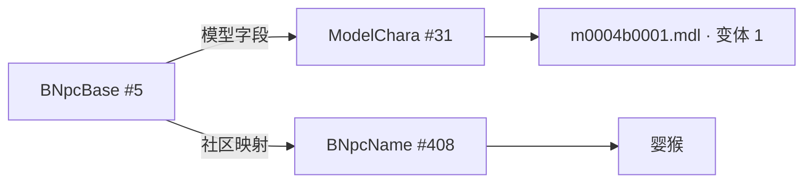

# 从名字找到模型

[知识库首页](README.md)

模型目录可以先读取游戏表，把名称、模型编号和资源路径连起来，再用 SqPack 索引确认文件存在。这样能快速列出可选择的条目，选中后才读取 MDL、IMC 和材质。

本页记录截至 2026-11-13 的实现与实测。目录验证使用国服简中构建 `2026.11.03.0000.0000`。字段解释按该版本核对，程序还会检查每张 EXH 的全部物理列编号、类型和偏移的 SHA-256 签名。其他构建需要重新核对布局。

## 名称与模型分属哪些表

| 表 | 作用 | 当前关联方式 |
| --- | --- | --- |
| `ModelChara` | 保存模型类型、模型编号、身体编号和变体 | 作为资源路径生成的中心 |
| `Companion` | 跟随玩家的小宠物 | 名称和 `ModelChara` 引用直接来自本地表 |
| `Pet` | 召唤兽名称 | 表内没有 `ModelChara` 外键，使用 TexTools 已核实的模型与身体组合，再取本地名称 |
| `Mount` | 坐骑 | 名称和模型引用直接关联 |
| `Ornament` | 阳伞等时尚配饰 | 名称和模型引用直接关联 |
| `BNpcBase` | 战斗 NPC 的基础数据和模型引用 | 模型直接关联，名字另查社区映射 |
| `BNpcName` | 战斗 NPC 名称文本 | 通过可靠的名称行号取本地简中名称 |
| `ENpcBase` | 事件 NPC 的模型和外观数据 | 对可构造单个资源路径的类型生成目录项 |
| `ENpcResident` | 事件 NPC 名称 | 与 `ENpcBase` 按同行 ID 关联 |

实现入口是 [LocalGameSource.NamedModels.cs](../src/FFXIVPatchParser/LocalGameSource.NamedModels.cs)。每条结果同时保存来源表、来源行、`ModelChara` 行、名称来源和可用的名称行号，便于从预览回到表格核实。

当前目录生成类型 3 的 monster、类型 2 的 demihuman 和类型 4 的 weapon 路径。亚人可能按装备部位展开成多条。人形 NPC 需要组合外观和装备，当前目录尚未完成这套装配。未被已知来源引用的可用模型会归入“其他模型”。

## 三个能沿表格复查的例子

| 名称 | 来源链 | 模型路径 |
| --- | --- | --- |
| 婴猴 | `BNpcBase #5` → `ModelChara #31`，社区映射指向 `BNpcName #408` | `chara/monster/m0004/obj/body/b0001/model/m0004b0001.mdl` |
| 典雅方格阳伞 | `Ornament #8` → `ModelChara #3012`，模型 6001、身体 3、变体 3 | `chara/monster/m6001/obj/body/b0003/model/m6001b0003.mdl` |
| USA蹦 | `Companion #212` 与 `ENpcBase #1017486` 均指向 `ModelChara #1402` | `chara/monster/m8168/obj/body/b0001/model/m8168b0001.mdl` |

USA蹦同时出现在宠物和事件 NPC 分类，说明一个模型可以承担多个游戏用途。阳伞放在 `monster` 资源族中，也说明资源族描述的是游戏内部组织方式，目录分类应以来源表为准。

### 路径中的 b 与骨架

`obj/body/b0003` 中的 `b0003` 是身体或基础模型编号。实际骨架是另一份 `.sklb` 文件，位于 `skeleton/base/...`。当前怪物动作实现读取 `skeleton/base/b0001/skl_mXXXXb0001.sklb`，支持范围和检查见[模型与动作](models-animation.md)。

验证骨架时先查 SKLB 文件，再用其中的骨骼名称与模型引用的名称对照。

### ModelChara 变体如何落到材质

`ModelChara.Variant` 先选择 IMC 子集，再由该部位的 `MaterialId` 决定 `material/vXXXX`。变体为 0 时取默认项，正数变体按 `Variant - 1` 读取变体数组。亚人还需要根据装备部位和 `PartMask` 找到相应条目。

典雅方格阳伞实测从 IMC 子集 3 得到材质编号 3。缺失部位、越界子集和材质编号 0 会报错。找不到 IMC 文件时，预览用 `max(1, Variant)` 作为材质编号。 [IMC 变体解析](../src/FFXIVPatchParser/LocalGameSource.NamedModels.Materials.cs)

## 战斗 NPC 名称为什么需要额外映射

从战斗 NPC 的基础行可以直接读出 `ModelChara` 引用。名称要先通过社区映射找到 `BNpcName` 的行号，再从对应构建的表读取文字。婴猴的两条链路如下。

项目使用固定版本的 Anamnesis 名称映射，并验证 Git blob 哈希。`B:0000005` 这样的键标识战斗 NPC 基础行。右侧值决定去哪里读取名称。Anamnesis 的贡献指南介绍了在游戏中选中 NPC、用工具查找名称行号，再提交到 `NpcNames.json` 的流程。 [Anamnesis 贡献指南](https://github.com/imchillin/Anamnesis/wiki/Notes-for-Community-Developers#finding-npc-names-from-their-appearances) · [NpcNames.json](https://github.com/imchillin/Anamnesis/blob/e180a0f124cb45db5bf56b283b41b8920a7e4c2e/Anamnesis/Data/NpcNames.json)

| 值的形式 | 处理方式 | 能保留的证据 |
| --- | --- | --- |
| `N:0000408` | 读取本地 `BNpcName #408` | 名称行号与本地简中原文 |
| `E:...` | 读取本地 `ENpcResident` 对应行 | 事件名称行号与本地原文 |
| 字面英文名称 | 保留社区名称，可追加经核对的中文翻译 | 社区别名来源，通常没有本地名称行号 |

字面英文翻译先查 [FFCafé 字符串数据库](https://strings-legacy.ffcafe.cn/) 的 `BNpcName.csv`。英文首行经过去空白和小写处理后精确匹配，只有所有命中的中文结果非空且唯一时才接受。网络查询失败时，优先复用已有翻译缓存，再使用固定版本的 InfSein `en` 与 `chs` 表按行号对照。具体下载、校验和唯一性筛选见 [NpcNameHints.cs](../src/FFXIVPatchParser/NpcNameHints.cs)。

字面别名及其翻译用于显示。需要按行跳转到 `BNpcName` 时，用有 `N:` 行号的映射。详情中的字面名称来源统一标为「Anamnesis 手工名字」，FFCafé 或 InfSein 翻译来源尚未逐条显示。

### InfSein 对照实际覆盖多少

研究固定在提交 [`9e2c05c`](https://github.com/InfSein/ffxiv-datamining-mixed/tree/9e2c05c0ed8205d5397031152f62a34900355de4)。该快照中的 `en`、`ja`、`chs` 三份 `BNpcName` 均为 15,001 行，文件通过 Git blob 校验。英文和日文表最后更新标记为 GLOBAL 7.56，简中为 CHS 7.58，三者属于同一仓库快照，但客户端版本不同。

固定版本的 Anamnesis 数据有 1,125 条字面名称映射，去重后剩 1,088 个名称。按英文精确匹配并得到唯一简中结果的有 28 个，覆盖 31 条映射，例如 `raptor` 对应「盗龙」。其余 1,060 个名称没有英文精确命中。作为交叉检查，28 个结果中有 27 个同时取得唯一非空的日文文本。

## 快速目录与深度扫描各在做什么

Godbert 从 `ModelChara` 筛出类型 3，按路径规则检查 IMC 和 MDL 是否存在，再组成模型、身体、变体层级。TexTools 把项目和依赖写入 SQLite 缓存，游戏版本或语言变化后可以重建。 [Godbert 怪物视图](https://github.com/xivapi/SaintCoinach/blob/master/Godbert/ViewModels/MonstersViewModel.cs) · [TexTools XivCache](https://github.com/TexTools/xivModdingFramework/blob/master/xivModdingFramework/Cache/XivCache.cs)

本项目的快速目录同样采用“读表 → 生成候选 → 索引确认”，结果保存在当前 `LocalGameSource` 实例中。召唤兽身份参考 [TexTools Companions](https://github.com/TexTools/xivModdingFramework/blob/master/xivModdingFramework/Items/Categories/Companions.cs)。[深度扫描实现](../src/FFXIVPatchParser/LocalGameSource.ModelCatalog.cs) 另行遍历容器中的资源地址并检查模型，可用于发现表目录覆盖之外的资源。

2026-11-13 的目录验证按来源统计条目数。

| 分类 | 条目数 |
| --- | ---: |
| 事件 NPC | 20,329 |
| 战斗 NPC | 16,913 |
| 宠物 | 589 |
| 坐骑 | 484 |
| 其他模型 | 256 |
| 时尚配饰 | 56 |
| 召唤兽 | 19 |
| 合计 | 38,646 |

38,646 的计数单位是目录条目。同一 MDL 可以被不同来源行、不同分类或变体重复引用，因此它衡量可浏览的关联记录数量。资源文件去重数、完整游戏模型数和有可靠名字的条目数需要分别统计。

该次首次调用约 0.612 秒，同实例再次调用约 0.000819 秒。计时从 `LocalGameSource` 构造完成后开始。这里的“首次”表示尚未生成实例内目录，操作系统文件缓存状态未控制，也未包含程序启动和预览加载时间。

## 复查与继续扩展

1. 记录客户端构建和语言，调用 `ListNamedModelsAsync`，保存分类计数与来源链摘要。
2. 检查三个示例的来源行、模型行、资源存在性，再单独调用 `ResolveNamedModelMaterialVariant`。
3. 对同一个实例重复调用，分别记录首次生成与命中缓存的耗时。需要比较物理文件数量时，另外按 `Path` 去重。
4. 扩展名称映射时保留基础行、名称行、数据版本和翻译来源。扩展人形 NPC 时增加外观与装备装配验证。

## 从容器地址恢复路径与 Diff 扫描

在国服简中构建 `2026.11.03.0000.0000` 上，模型扫描先检查索引地址的资源类型，再用仓库、资源类别和 64 位索引哈希匹配已知路径。命中后还要确认本地安装中存在该路径。索引只存哈希，查不到路径或匹配到多个候选时保留 `sqpack:容器@偏移#哈希`。角色或物件的中文名称需另查来源表。 [模型扫描](../src/FFXIVPatchParser/LocalGameSource.ModelCatalog.cs) · [路径目录](../src/FFXIVPatchParser/LocalGameSource.ModelPaths.cs)

路径来源包括已加载的本地命名模型目录、通过 EXH 签名检查的 `ModelChara` 候选、常见角色/装备路径，以及用户导入的 UTF-8 文本目录。文本格式为每行一个游戏内 `.mdl` 路径；在“扫描容器索引”视图点击“导入已知模型路径”，再扫描即可。导入会与 `tmp/model-paths/catalog.txt` 合并去重，清除当前实例的完整模型扫描缓存。其他已打开的游戏源实例需要重新打开才会读取新目录。路径列表不包含模型内容。

### 场景样例实测

研究使用 [FFXIV Explorer 的 hashlist.7z](https://github.com/goaaats/ffxiv-explorer-fork/blob/9f4f4f9a69c6d6aa53a89b3069d1b5f883d8afdb/hashlist.7z)。下载归档的 SHA-256 为 `61484431EB0A667756344745AB33EF8B6F383D993AF9A297C40E4F1C2D9E0115`。从 SQLite 的 `fullpaths`、`folders`、`filenames` 表导出并去重得到 163,763 条 `.mdl` 候选。这是该字典样本的数量，不代表当前游戏全部模型。

该来源仓库的许可证 API 未提供可识别的许可证，字典也未核实独立再分发授权。因此数据库、解压文件和导出列表只用于 `tmp/` 本地研究，不随程序或知识库分发。工具提供用户导入入口，不自动下载或打包该字典。

| 索引定位 | 实测恢复路径 | 本地预览 |
| --- | --- | --- |
| `sqpack:ex1/020102.win32.dat0@103B4700#E520DF11FCBE63EB` | `bg/ex1/02_dra_d2/dun/d2d6/bgplate/0048.mdl` | 3 个网格、3 个材质 |

该容器全扫得到 5,687 个模型，字典恢复其中 5,526 条路径。剩余 161 条继续保留原始地址。常见角色路径推导无法覆盖场景目录，外部字典的覆盖程度也随游戏版本和采集范围变化。

### 性能范围与校验边界

[补丁模型扫描](../src/FFXIVPatchParser/PatchImageScanner.cs)先求写入区间与索引存储区间的交集，再读取候选 DAT 文件头。它仍使用相邻索引地址确定存储区间，保留对齐填充。按范围扫描不会写入完整容器缓存，随后全扫仍能取得全部条目。角色路径枚举改用索引哈希集合，并先排除不存在的装备目录，避免为约百万候选逐一查询文件是否存在。

单容器测试在 `LocalGameSource` 构造完成后计时。测试沿用系统的文件缓存。

| 样本与阶段 | 优化前 | 最终实现 |
| --- | ---: | ---: |
| `ffxiv/040000.win32.dat0` 首次模型目录 | 11.689 秒，14,969 条，12,224 条已知路径 | 2.879 秒，14,969 条，13,545 条已知路径（含外部目录与 ModelChara 补全） |
| `ex1/020102.win32.dat0` 新实例全扫 | 未测 | 1.251 秒，5,687 条 |
| 同场景容器，新实例仅上述模型的存储区间 | 未测 | 0.934 秒，1 条，与全扫取交集一致 |
| 范围扫描后同实例全扫 | 未测 | 0.183 秒，仍为 5,687 条 |

上述场景测试另有 7.294 秒的游戏源初始化耗时。已验证取消请求生效，已知路径与未知地址都能读取模型。

另测 `0.0.0.30 → 0.0.0.31` 全部模型相关容器。从游戏源初始化完成后计时，共 125.68 秒，筛出 8 个写入候选。校验目标文件和分析差分合计 123.88 秒，之后的索引筛选约 1.80 秒。抽查的场景模型 `w_xma_009_03a.mdl` 和装备模型 `c0201e0167_sho.mdl` 均能预览。选择单个容器时只校验该容器和对应索引，可缩短等待。 [SqPack 与媒体资源](sqpack-media.md)
