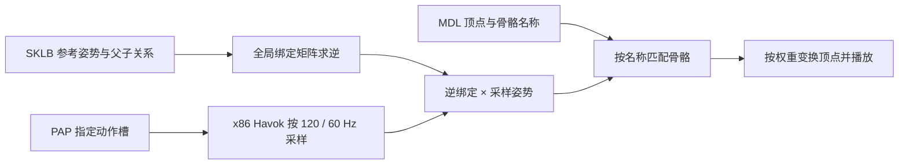

# 模型预览、骨架与动作

[知识库首页](README.md)

项目已完成 MDL 静态预览，以及通过本机 Godbert 的 x86 Havok 解码器采样怪物动作、按骨骼名称蒙皮的播放链路。当前实测覆盖三个怪物本体样本。完整游戏材质、人形角色装配和 FBX 动作导出仍属于后续工作。

本页整理 2026-11-13 对国服简中构建 `2026.11.03.0000.0000` 的验证，分别说明项目实现、上游实现和待扩展范围。模型名称与来源表见[模型目录](model-catalog.md)。

## 从 MDL 到可见网格

项目读取 LOD 0 主网格，按顶点声明定位坐标、法线、第一组 UV 和蒙皮数据。每个顶点属性按声明的流偏移、步长和元素类型解码。 [MDL 网格读取](../src/FFXIVPatchParser/LocalGameSource.Models.cs)

| 内容 | 当前处理 |
| --- | --- |
| 位置 | 支持 `Single3`、`Single4` 和 `Half4` |
| 三角面 | 读取 16 位索引，检查顶点范围和三角形完整性 |
| 法线与 UV | 读取受支持的浮点或半精度格式，使用 `UsageIndex == 0` 的属性 |
| 材质 | 保留每个网格的材质索引，解析 MTRL 引用 |
| 骨骼 | 读取骨骼名称和 mesh 的 bone palette，再解析每顶点索引及权重 |
| 预览上限 | 100 万顶点、200 万三角面，实时动作界面另限制为 10 万顶点 |

当前使用主网格，边缘几何等未支持布局会给出错误。后续如需复现更多角色外观，还要处理部位隐藏、形变和游戏中的装配规则。

### 材质定位与预览

程序根据模型根目录、材质名和已解析的材质变体定位 MTRL，并保留 shader package 名和纹理路径。部分装备共享人形皮肤材质，定位时也会检查相应的人形路径。 [材质与纹理读取](../src/FFXIVPatchParser/LocalGameSource.Models.Materials.cs)

当前显示 `_d.tex` 或 `_base.tex` 原始漫反射纹理。缺少独立漫反射纹理时显示灰模，法线、遮罩和高光贴图仍作为材质依赖记录。染色、colorset 和游戏 shader 的组合效果尚未实现。

USA蹦读出两个网格和两个材质，预览显示原始漫反射纹理。典雅方格阳伞读出一个网格和一个材质，IMC 子集 3 对应材质编号 3。该材质没有独立漫反射纹理，当前预览为灰模。

## 怪物 Idle 在共享 PAP 的槽里

怪物常见的待机与移动动作存于以下共享 PAP。

```text
chara/monster/mXXXX/animation/a0001/bt_common/resident/monster.pap
```

`cbnm_id0` 是优先使用的 Idle 槽名，找不到时尝试 `cbbm_id0`。仅拼接 `idle.pap`、`walk.pap` 会漏掉这个共享动作包。这个入口同时得到 [Godbert MonstersViewModel](https://github.com/xivapi/SaintCoinach/blob/master/Godbert/ViewModels/MonstersViewModel.cs) 和本地样本验证。

程序还从 `ActionTimeline` 字符串和常用动作名生成候选，再用索引确认路径存在。PAP 元数据读取器检查文件头、40 字节槽记录与 Havok 数据范围，取出槽名和槽索引。时长和姿势由 Havok 解码取得，播放前还要检查骨架兼容性。 [PAP 路径与槽读取](../src/FFXIVPatchParser/LocalGameSource.Animations.cs)

## 真正的动作采样链路



### 用 x86 进程调用 Havok

本机验证的 `hkAnimationInterop.dll`、`fbxInterop.dll` 和 `libfbxsdk.dll` 都是 I386 架构。直接在 x64 进程加载会产生 `BadImageFormatException`。Havok 桥接库还依赖 VC++ 2012 x86 运行库。

`hkAnimationInterop.dll` 用于从 SKLB 读取骨架并从 PAP 采样姿势。本机样本的 Git blob 与 SaintCoinach `0b22b78` 随附的预编译 DLL 一致。上游公开了 C# 调用层，目前未找到明确覆盖二进制所含 Havok 组件的再分发授权。程序通过「设置 → Godbert 动作解码库」使用本机已安装的副本，保存前检查文件是否为 x86 原生 DLL。 [上游二进制](https://github.com/xivapi/SaintCoinach/blob/0b22b78/SaintCoinach.Graphics.Viewer/hkAnimationInterop.dll) · [调用层](https://github.com/xivapi/SaintCoinach/blob/0b22b78/SaintCoinach.Graphics.Viewer/Interop/HavokInterop.cs) · [Godbert 发布页](https://github.com/xivapi/SaintCoinach/releases/tag/0b22b78)

程序首次通过系统 32 位 PowerShell 编译本项目的 x86 调用程序，之后直接启动缓存的调用程序，从用户选定的 Godbert 安装目录加载 DLL，解析 SKLB 和 PAP 中的 Havok 数据，预览优先以 120 Hz 采样，完整顶点缓存超出 64 MiB 或骨骼帧超过上限时自动选择 60 Hz。调用程序按源码摘要存于 `tmp/animation-cache/helpers/`，不包含 Godbert 原生 DLL。每次未命中内存缓存的采样单独保存临时输入和姿势输出，结束时清理；取消或超过 90 秒会终止子进程。 [Havok 采样入口](../src/FFXIVPatchParser/LocalGameSource.Havok.cs)

### 用逆绑定矩阵蒙皮

Havok 返回模型空间中的采样姿势。骨架参考姿势保存各骨骼相对父骨骼的局部变换。程序按以下顺序计算每帧的顶点位置。

1. 按行向量约定组成 `Scale × Rotation × Translation`。
2. 沿父骨骼链累乘参考姿势，得到全局绑定矩阵 `B`。
3. 对每帧采样姿势 `P(t)` 计算 `inverse(B) × P(t)`。
4. 顶点先通过 mesh bone palette 找到 MDL 骨骼，再按名称匹配解码骨架，按权重累加变换后的位置。

这一步使绑定姿势中的顶点正确进入动作姿势。MDL 与 SKLB 的骨骼数量和排列可能不同，按名称连接可以处理顺序变化。实现见 [Skinning.cs](../src/FFXIVPatchParser/LocalGameSource.Skinning.cs)，上游骨架与动画接口可参看 [Skeleton](https://github.com/xivapi/SaintCoinach/blob/master/SaintCoinach.Graphics.Viewer/Skeleton.cs)、[Animation](https://github.com/xivapi/SaintCoinach/blob/master/SaintCoinach.Graphics.Viewer/Animation.cs) 和 [AnimatedModel](https://github.com/xivapi/SaintCoinach/blob/master/SaintCoinach.Graphics.Viewer/AnimatedModel.cs)。

## 实测样本与目前覆盖

下表比较同一模型在 0 秒和 0.5 秒的蒙皮顶点位置。最大位移使用资源坐标单位，记录的是数值验证结果。

| 模型 | Idle 槽 | MDL / 骨架骨骼数 | 时长（秒） | 30 fps 采样帧数 | 发生变化的顶点 | 最大位移 |
| --- | --- | ---: | ---: | ---: | ---: | ---: |
| `m0001` | `cbnm_id0` | 35 / 46 | 2.3333333 | 70 | 2,973 / 2,973 | 0.02352756 |
| `m0002` | `cbbm_id0` | 32 / 35 | 2 | 60 | 514 / 514 | 0.0228054 |
| `m0003` | `cbnm_id0` | 35 / 40 | 2.6666667 | 81 | 1,466 / 1,466 | 0.017085155 |

上表保留最初 30 Hz 实测结果；`m0003` 的 81 帧来自当时 `ceil(duration × 30)` 的浮点计算结果。单独的蒙皮检查还验证了骨骼名称重排、加权平移、单位绑定姿势，并确认缺失骨骼和模型不匹配会被拒绝。顶点发生变化证明采样结果进入了网格，画面正确性还需结合视口观察。

| 范围 | 当前状态 |
| --- | --- |
| 模型和 PAP | 怪物本体路径，PAP 必须属于同一 monster ID |
| 骨架路径 | 当前固定读取该怪物 `skeleton/base/b0001` |
| SKLB 版本 | 代码接受 `0021`、`0031`、`0032`，本地样本实际覆盖前两种 |
| 权重 | 四个字节骨骼索引与四个字节归一化权重，八权重布局待支持 |
| 骨骼兼容性 | 所有被顶点引用的骨骼都需按名称匹配，未绑定顶点会报错 |
| 资源上限 | 动作最多 120 秒、1,024 根骨骼、100 万骨骼帧 |
| 播放 | 采样后更新顶点位置，界面实现见 [ModelPreview.Playback](../src/FFXIVPatchParser.Desktop/ModelPreview.Playback.cs) |
| 游戏行为 | 当前播放指定片段，动作混合、状态机、特效同步等待扩展 |

## Godbert 的 FBX 导出

Godbert 的导出代码把 LOD 0 网格、骨架和收集到的 PAP 一起传给 `FbxExport.ExportFbx`，同时导出对应材质。这条上游实现提供了后续接入的参考，见 [MonstersViewModel](https://github.com/xivapi/SaintCoinach/blob/master/Godbert/ViewModels/MonstersViewModel.cs) 和 [FbxExport](https://github.com/xivapi/SaintCoinach/blob/master/SaintCoinach.Graphics.Viewer/Interop/FbxExport.cs)。

本项目要接入 FBX 导出，还需把网格、骨架和动作传给原生导出器，验证 FBX SDK 依赖和导出文件中的动画轨道。

## 复现动作播放

1. 记录客户端构建和语言，选定完整 MDL 路径，读取静态预览并检查材质警告。
2. 调用 `ListModelAnimationPaths`，读取 `monster.pap` 槽表，优先选 `cbnm_id0`，其次 `cbbm_id0`。
3. 使用本机 Godbert 调用 `BakeModelAnimationAsync`，记录骨骼数量、时长和帧数。
4. 调用 `SkinModelFrame` 对照 0 秒与 0.5 秒的顶点，再在视口检查播放和停止行为。
5. 增加新模型族、SKLB 版本或权重布局时，分别记录“找到资源”“解码成功”“蒙皮正确”“画面验证”的结果。

## 默认 Idle 与播放调度验证

2026-11-13 在同一国服简中构建 `2026.11.03.0000.0000` 上，以 `m0001` 本体、`cbnm_id0`、2,973 顶点和 70 个采样帧复测。下面先保留 30 Hz 阶段的本项目 Release 构建测量，再列出 60 Hz 改动后的结果；不代表所有机器或模型。

- 300 次帧准备的均值：CPU 蒙皮 0.083 毫秒，逐点 `Point3DCollection.Add` 为 0.308 毫秒，数组批量构造并冻结为 0.059 毫秒。这个小模型的 CPU 蒙皮不足以解释明显的低帧率。
- 在实际 WPF 预览窗口同时记录 5 秒：旧 33 毫秒 `DispatcherTimer` 只触发 98 次，约 19.6 次/秒；渲染时钟驱动的播放器完成 150 次动作帧更新，达到资源采样率 30 fps。这里统计的是界面提交的动作帧，未测 GPU 呈现帧率；旧定时器的延迟原因尚未独立拆分到系统定时精度和 Dispatcher 排队。
- 30 Hz 阶段按经过时间选帧，用 `CompositionTarget.Rendering` 调度；后台完成蒙皮与冻结坐标集合，界面线程只更换坐标引用。单个片段的顶点缓存估算不超过 64 MiB 时逐帧复用，否则仅准备当前帧。该上限针对坐标数据，不包含对象开销与原始骨骼采样。
- 配置了可用 Godbert 目录时，怪物本体打开后直接尝试共享 `monster.pap`，有 `cbnm_id0` 或 `cbbm_id0` 才自动播放。未配置或不受支持的模型仍显示静态预览。播放按钮可暂停和继续；停止恢复静态姿势。
- 自动验证通过默认 Idle、暂停时姿势保持、继续、切换动作槽停止旧动作，以及换来源后旧采样不能回写。验证脚本、计时输出均放在 `tmp/`；尚未测量复杂大模型的实际 GPU 开销。

实现见 [播放与帧缓存](../src/FFXIVPatchParser.Desktop/ModelPreview.Playback.cs) 和 [模型加载与默认动作](../src/FFXIVPatchParser.Desktop/ModelPreview.xaml.cs)。

### 60 Hz 采样与切换后自动播放

同日、同构建和同语言，以同一 `m0001` Idle 样本复测本项目 Debug 构建：

- Havok 直接按 `getPose(clip, frame / 60)` 取得 140 帧，原先 70 帧之间新增的 70 个奇数帧全部存在顶点位移（与前一帧比较，阈值 `1e-7`）。因此新增帧含实际姿势变化，并非重复显示旧帧。
- 在相同 64 MiB 坐标数据预算内，启动前准备并冻结完整片段；本样本缓存 140/140 帧。超出预算仍逐帧准备，骨骼矩阵总量仍限制为 100 万个。120 秒的时长限制对应最多 7,200 个采样帧。
- 短片段完整缓存后，用回调到达时的 `Stopwatch` 选帧仍仅测得约 51 次提交/秒。改用 `RenderingEventArgs.RenderingTime` 的预计呈现时刻后，两轮各 5 秒均记录 296 次动作帧变化，约 59.2 次/秒。暂停后继续会重新对齐时钟，播放速度仍由时间和动作时长决定。
- 这验证了本机小模型的 60 Hz 采样和接近 60 fps 的界面姿势提交。它不是 GPU 实际呈现帧率测量，也不保证复杂模型、后台窗口或低刷新率显示器稳定达到 60 fps。
- 选择或输入新的 PAP 后自动播放：优先选择 `cbnm_id0`、其次 `cbbm_id0`、最后第一个槽；手动切换槽也直接播放。模型初次加载仍只自动尝试已知 Idle。初始化槽列表时抑制槽切换播放事件，避免重复解码。
- WPF 验证通过默认 Idle、暂停保持姿势、继续、切槽自动播放、切 PAP 自动播放、采样期间隐藏窗口取消，以及切换数据源后旧采样不回写。采样和坐标准备两次等待结束后均检查取消、可见性和场景，临时验证程序留在 `tmp/`。


### PAP 加载提速与 120 Hz 试验

2026-11-13 在国服简中构建 `2026.11.03.0000.0000` 上继续使用 `m0001` 本体和共享 `monster.pap`，测量 `cbnm_id0`（槽 9）与槽 0。以下为本项目单机实测，加载计时包含资源读取、外部采样和矩阵解析，不包含视口准备。实现见 [Havok 调用层](../src/FFXIVPatchParser/LocalGameSource.Havok.cs) 与 [PAP 元数据解析](../src/FFXIVPatchParser/LocalGameSource.Animations.cs)。

| 场景 | 修改前 | 修改后 |
| --- | ---: | ---: |
| 首次调用，包含调用程序编译 | 1,342 ms | 1,493 ms |
| 切换至未缓存动作槽 | 957 ms | 91 ms |
| 再次选择已采样动作槽 | 916 ms | 0.90 ms |
| 新会话复用已编译调用程序，首次采样 | 未单独测量 | 130 ms |

调用程序直接启动后，新槽采样省去了 PowerShell 启动和每次 `Add-Type` 编译。每个游戏来源实例保留最多 16 个最近使用的片段，骨骼矩阵等估算总量限制为 64 MiB；缓存键包含模型、PAP、槽、采样策略、预览顶点数及解码 DLL 的位置、大小和修改时间。失败或取消的结果不进入缓存，同来源的采样串行执行。PAP 在一次采样中只读取一次，解析和矩阵转换在后台运行；12 浮点数的临时变换使用栈空间，减少逐骨骼分配。游戏资源和姿势只写入独立临时目录，不持久缓存。

120 Hz 通过采样 API 的 `samplingRate: 120` 试验。相同 Idle 得到 280 帧，140 个新增奇数帧均有真实顶点变化；准备全部冻结坐标耗时约 180 ms。向现有 WPF 播放器注入这组采样和缓存，在可见预览窗口记录 5 秒：580 次渲染回调、579 次姿势更新，即 115.8 次/秒。相同环境的 60 Hz 对照得到 298 次姿势更新，即 59.6 次/秒。这里统计界面提交，不代表 GPU 实际呈现帧率。

复杂样本使用 `m0300` 本体、共享 `monster.pap` 的默认 Idle，共 47,890 顶点、4 秒。显式 120 Hz 生成 480 帧，完整坐标数据约需 526 MiB，超过缓存预算后逐帧蒙皮，5 秒实测 513 次姿势更新（102.5 次/秒）；60 Hz 对照为 292 次（58.4 次/秒）。两组均不缓存完整顶点，120 Hz 在此样本明显未达到目标。

最终预览采用自适应策略：请求 120 Hz，同时传入预览顶点数；原生调用程序取得动作时长和骨骼数后，按 `ceil(duration × 120) × vertices × 24` 估算完整顶点缓存。超过 64 MiB 或超过 100 万骨骼帧时直接以 60 Hz 采样，避免先完成 120 Hz 再解码一次。缓存键区分显式采样与预览策略。显式 API 调用不传顶点数时仍严格使用所指定的 60 / 120 Hz；桌面实际使用自适应入口，状态栏显示最终采样频率。120 秒时长与 100 万骨骼帧上限保持不变。

小模型可使用 120 Hz 的完整缓存，复杂模型或长动作回落至 60 Hz。该判断是缓存预算策略，不能保证低刷新率显示器、后台窗口或其他机器达到采样频率；播放器仍按经过时间选帧。临时程序和测试日志位于 `tmp/`。
最终自适应入口的 WPF 回归中，`m0001` 自动选为 120 Hz（280 帧完整缓存），5 秒提交 584 次姿势更新（116.8 次/秒）；`m0300` 自动选为 60 Hz（240 帧、不缓存完整顶点），5 秒提交 291 次（58.2 次/秒）。小模型同时通过默认 Idle、暂停/继续、切槽和切 PAP 自动播放、隐藏时取消，以及切换来源后旧采样不回写。当前 x86 调用程序大小约 9 KiB。
