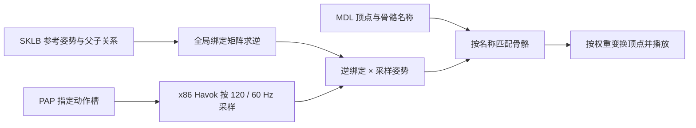

# 模型预览、骨架与动作

[知识库首页](README.md)

项目可预览静态 MDL，并通过本机 Godbert 的 x86 Havok 解码器采样 PAP，按名称映射骨骼并更新网格顶点。实测覆盖怪物、亚人和各族人形部件。完整游戏材质、人形角色装配和 FBX 动作导出仍属于后续工作。

## 阿莉塞上衣的正反面

国服简中构建 `2026.11.03.0000.0000`，选择 NPC 阿莉塞（ENpcBase 1019983，体型 `c0604`），从背面观察腰后衣摆。上衣、裤、鞋均为 `e9114` 的 IMC 子集 1。逐个对比上衣 LOD0 三角面的三个顶点坐标（保留五位小数），材质 B 的 164 个面中有 158 个与材质 A 重合，这 158 个面的绕序全部相反。两个材质的 MTRL 标志均为 `0x01`。同时绘制正反面会让衣料表里在同一深度争用像素。

[模型预览](../src/FFXIVPatchParser.Desktop/ModelPreview.xaml.cs) 按 MTRL 第 0 位决定是否剔除背面，贴图显示与灰模预览使用相同的可见面。WPF 离屏渲染用同一镜头对比该造型待机的 0.50 秒，两次保持同一套顶点和材质。按标志剔除背面后，腰带下方露出的底层三角和裙摆的交错斑块消失。[Penumbra.GameData 的 ShaderFlags](https://github.com/Ottermandias/Penumbra.GameData/blob/main/Files/Materials/ShaderFlags.cs) 将该位命名为 `HideBackfaces`。

本页整理 2026-11-13 对国服简中构建 `2026.11.03.0000.0000` 的验证，分别说明项目实现、上游实现和待扩展范围。模型名称与来源表见[模型目录](model-catalog.md)。

## 从 MDL 到可见网格

项目读取 LOD 0 主网格，按顶点声明定位坐标、法线、第一组 UV 和蒙皮数据。每个顶点属性按声明的流偏移、步长和元素类型解码。 [MDL 网格读取](../src/FFXIVPatchParser/LocalGameSource.Models.cs)

| 内容 | 当前处理 |
| --- | --- |
| 位置 | 支持 `Single3`、`Single4` 和 `Half4` |
| 三角面 | 读取 16 位索引，检查顶点范围和三角形完整性 |
| 法线与 UV | 读取受支持的浮点或半精度格式，使用 `UsageIndex == 0` 的属性 |
| 材质 | 保留每个网格的材质索引，解析 MTRL 引用 |
| 骨骼 | 读取骨骼名称和 mesh 的 bone palette，再解析每顶点索引及权重 |
| 预览上限 | 100 万顶点、200 万三角面，实时动作界面另限制为 10 万顶点 |

当前使用主网格，边缘几何等未支持布局会给出错误。后续如需复现更多角色外观，还要处理部位隐藏、形变和游戏中的装配规则。

### 材质定位与预览

程序根据模型根目录、材质名和已解析的材质变体定位 MTRL，并保留 shader package 名和纹理路径。部分装备共享人形皮肤材质，定位时也会检查相应的人形路径。 [材质与纹理读取](../src/FFXIVPatchParser/LocalGameSource.Models.Materials.cs)

基础材质优先按 MTRL 的采样器识别漫反射纹理，路径后缀用于回退。已核实的角色材质可从染色参数、通道遮罩与色表生成基色；其他无法解释的材质保留灰模。法线、遮罩和高光贴图仍可从材质依赖中查看。

USA蹦读出两个网格和两个材质，预览显示原始漫反射纹理。典雅方格阳伞读出一个网格和一个材质，IMC 子集 3 对应材质编号 3；该 MTRL 没有独立漫反射纹理，已核实色表与索引贴图时可据此生成近似基色。

### 角色配色与装备基色

国服简中构建 `2026.11.03.0000.0000` 实测，`CharaMakeType` 的列 0、1、2 分别是种族、部族、性别。`Tribe` 提供部族名称；色值来自 `chara/xls/charamake/human.cmp`，本构建为 186,752 字节。肤色、发色随部族和性别变化；挑染、瞳色用共享色板。CMP 同时保存界面色块与传给渲染的颜色，按同一色号分别读取。格式和用途可对照 [Anamnesis 色板](https://github.com/imchillin/Anamnesis/blob/243411ba43eec07868ce23fbcfa730f3e71c75a8/Anamnesis/Actor/Utilities/ColorData.cs) 和 [Penumbra.GameData 的 CMP 结构](https://github.com/Ottermandias/Penumbra.GameData/blob/main/Files/CmpData.cs)。

同一构建的拉拉菲尔女性（`c1201`）在 `CharaMakeType` 第 9、11 行分别对应平原之民和沙漠之民。两行第 2 个零基菜单的 Customize 值为 5，选项数为 4，第 201、229、257、285 列给出四张脸型图标，范围分别为 133301–133304 和 133801–133804。两部族对应模型目录分别是 `f0001`–`f0004` 和 `f0101`–`f0104`，同序号首张脸各自引用本目录的脸部与虹膜材质。男性 `c1101` 也有这八个模型，图标范围为 133101–133104、133601–133604。按默认色号取 CMP，两个部族肤色依次为 `#A3A589`、`#A99F88`，发色均为 `#121212`。角色预览的脸型列表只显示当前部族的创建菜单选项，切换部族时保留菜单序号。逐项核对本构建已支持的 17 个体型，31 个性别与部族组合的 128 个菜单项均有对应 MDL。猫魅族两性和拉拉菲尔族一样，首部族使用 1–4，次部族使用 101–104。高地之民男性使用 101–104。敖龙族和维埃拉族的两部族共用 1–4，硌狮族共用 5–8，各自保留部族图标。此处核对的是模型路径和菜单图标；共用模型的部族材质差异仍待验证。[本项目色板和脸型映射](../src/FFXIVPatchParser/LocalGameSource.CharacterColors.cs) · [MultiAssist 的拉拉菲尔脸型编号说明](https://github.com/ilmheg/MultiAssist/wiki/3.3.-Guide:-Using-FFXIV-meshes-with-your-FBX-animation-%28Blender%29)

| 样本 | 预览如何合成 |
| --- | --- |
| `hair.shpk` 发片 | 没有独立基色贴图。法线 B 决定发色和挑染的混合，法线 A 决定覆盖，遮罩 A 提供明暗。 |
| `skin.shpk` 和 `iris.shpk` | 皮肤按法线 B 染色，脸部透明沿用基色 A；虹膜按遮罩 B 染色，保留眼白。 |
| `c1801` 的 `e0581` 初始装备 | 部分 MTRL 无基色采样器。索引贴图 R 选色表中的一对行，G 决定两行的混合；读取行首三个 Half 得到基色。法线的透明遮罩仍参与预览。 |

使用「预览角色」并展开「角色配色」可以选游戏色号。更换颜色只更新贴图，保留相机、骨骼与已有动作。上述通道用法对照 [Penumbra 材质导出器](https://github.com/xivdev/Penumbra/blob/testing/Penumbra/Import/Models/Export/MaterialExporter.cs)，当前为离线基色预览。装备染料的模板、高光、材质光照和其余着色参数仍待还原。实现见 [色板读取](../src/FFXIVPatchParser/LocalGameSource.CharacterColors.cs) 和 [材质合成](../src/FFXIVPatchParser/LocalGameSource.CharacterSurface.cs)。

### 换装与武器姿势

防具材质优先采用物品选定的 IMC 变体，角色固有部件按自身材质目录读取。国服简中 `2026.11.03.0000.0000` 将预览变体设为 9 后，17 个预设的 243 个材质引用均有资源。截图中的 `c0801` 共 15 个引用，`e0089` 的四件装备以及头发和尾巴分别找到了 `v0001` 的材质。 [角色组合](../src/FFXIVPatchParser/LocalGameSource.CharacterPreview.cs)

按 `chara/xls/weapontype/attach.wtd` 找武器类型，再读当前体型 ATCH 的状态 0 和 1，取挂点名、缩放、平移与旋转。`c0801`、`c1201` 的 `w0621` 弓实测从 `n_buki_l` 切到 `j_buki_sebo_r`。武器自身的 `resident/weapon.pap` 提供对应的战斗、收纳姿势，样本弓的 `cbbw_id0`、`cbnw_id0` 均能按其 SKLB 采样。预览采用 XYZ 欧拉顺序和首帧稳定姿势，客户端过渡动作及旋转顺序还需逐帧对照。 [挂点读取](../src/FFXIVPatchParser/LocalGameSource.WeaponAttachment.cs)

换装时以新网格重建蒙皮绑定，继续使用同一动作时间。WPF 离屏实测 `c0101` 的 `original.pap` 在 1.667 秒暂停，换发型后保持同一动作实例、相位和暂停状态，恢复播放再更换上装时继续运行。换脸后按实际选中的脸型模型解析 EST，并用该骨架重新采样面部动作。`c0801` 的 `prettyplease` 五份样本均用槽 `0`。`f0002`、`f0202`、`f0204`、`f0210` 匹配的四套组合均可采样三帧（60 Hz），`f0251` 还没有匹配的可选脸型样本。`mt_m0605` 经 `ModelChara #2752` 关联到 `Mount #200`「魔界花」，`mount.pap` 三槽在 60 Hz 下分别得到 200、200、30 帧。 [动作与关联](../src/FFXIVPatchParser/LocalGameSource.AnimationNames.cs) · [桌面动作预览](../src/FFXIVPatchParser.Desktop/ModelPreview.Playback.cs)

### 头部和上衣的附加骨

装配带独立骨的装备时，按体型和模型编号从 `extra_met.est` 或 `extra_top.est` 读取 SKLB 编号。解码骨层后，蒙皮沿父级寻找身体动作采样中存在的最近骨骼，保留原顶点权重。国服简中 `2026.11.03.0000.0000` 的拉拉菲尔女性穿上白金咏咒头饰 `#9072`（`e0227`）时，`j_ex_met_a` 随 `j_kao`。实测鞠躬中的 64 个相关顶点与按祖先骨计算的位置一致。使用截图中的 `battle08.pap` 在 0.43 秒暂停再换上此头饰，桌面预览保持暂停和相位。`e0541` 上衣也验证了肩部附加骨的多级继承。

附加骨架不可读取时，头饰可以随头骨运动。上衣中缺少可靠映射的附加权重保留参考姿势，身体动作继续播放，预览状态提供原因。已用损坏的解码模块实测上述回退，同时验证独立面部与身体叠加的表情轨。 [装备骨架](../src/FFXIVPatchParser/LocalGameSource.EquipmentSkeleton.cs) · [蒙皮](../src/FFXIVPatchParser/LocalGameSource.Skinning.cs)

## 怪物 Idle 在共享 PAP 的槽里

怪物常见的待机与移动动作存于以下共享 PAP。

```text
chara/monster/mXXXX/animation/a0001/bt_common/resident/monster.pap
```

`cbnm_id0` 是优先使用的 Idle 槽名，找不到时尝试 `cbbm_id0`。仅拼接 `idle.pap`、`walk.pap` 会漏掉这个共享动作包。这个入口同时得到 [Godbert MonstersViewModel](https://github.com/xivapi/SaintCoinach/blob/master/Godbert/ViewModels/MonstersViewModel.cs) 和本地样本验证。

程序还从 `ActionTimeline` 字符串和常用动作名生成候选，再用索引确认路径存在。PAP 元数据读取器检查文件头、40 字节槽记录与 Havok 数据范围，取出槽名和槽索引。时长和姿势由 Havok 解码取得，播放前还要检查骨架兼容性。 [PAP 路径与槽读取](../src/FFXIVPatchParser/LocalGameSource.Animations.cs)

## 从 PAP 路径查动作名称

以国服简中 `2026.11.03.0000.0000` 的 `chara/human/c1801/animation/a0001/bt_2st_emp/event/event_bt_deactive.pap` 为例：

| 路径或数值 | 本地核对结果 |
| --- | --- |
| `c1801` | 女维埃拉体型，种族名来自 `Race #8`。两支部族共享此体型。 |
| `a0001` | 该体型的动作资源目录编号，不是 `Action #1`。 |
| `bt_2st_emp` | 常驻动作集键，出现在 `ResidentMotionType #10`、`#17`、`#30`。同一键可被多行引用。 |
| `event/event_bt_deactive` | 匹配 `ActionTimeline #5718`、`#7344` 和 `CutActionTimeline #12`；`Emote #237` 的名称是「收回武器」。 |
| `cbbm_event_bt_deactive` | 这份 PAP 实际读取到的第 0 槽名。槽名和整条资源路径是两层标识。 |

技能名称通过 `Action` 的咏唱开始、施放、命中字段反查，咏唱开始先经过 `ActionCastTimeline`；情感动作通过 `Emote` 的时间线引用反查。一个键可能有多个名称或用途，界面保留每条来源。路径完整键匹配保留内层目录，例如 `ws/bt_swd_sld/wsh001` 对应含「先锋剑」的多条技能记录；不能只用 `wsh001` 配对。

播放包和时间线也可能通过槽名关联。实测「火炎」`Action #141` 的施放指向 `ActionTimeline #473`；`chara/action/magic/thm_black/fire.tmb` 的 `C010` 条目引用 `cbbm_mgc_thm_3`，这个名字也见于 `MotionTimeline #81`。同名槽见于 `c0101/animation/a0001/bt_common` 下的 `resident/action.pap` 和 `magic/thm_black/mgc021.pap` 等资源。仅凭槽名不能确定客户端在所有状态下选择哪份 PAP；同名槽关联还要求对应的模型或动作目录匹配，并保留来源。过场资源则可按目录核对所属的 `Cutscene`。TMB 字符串位置可对照 [VFXEditor 的 C009](https://github.com/0ceal0t/Dalamud-VFXEditor/blob/49012104303caae373ac4b37b385a3affedca472/VFXEditor/Formats/TmbFormat/Entries/C009.cs) 与 [C010](https://github.com/0ceal0t/Dalamud-VFXEditor/blob/49012104303caae373ac4b37b385a3affedca472/VFXEditor/Formats/TmbFormat/Entries/C010.cs)。

同一构建按已知路径检查了 `chara`、`cut` 的 91,078 个 PAP。仅按路径已有 12,065 个可关联到技能或情感动作名称，28,929 个可关联到动作、演出或过场记录（包含前者，不计仅匹配种族或动作集的文件）。这是本地已知路径的覆盖结果，不含打开时由 PAP 槽补充的关联，也不包括未知路径。模型可按路径、已匹配的名称或常驻动作包中可核对的名称筛选。打开任意 PAP 可查看适用的表行和槽；文件系统保留 Hex，查不到完整路径也可从 PAP 文件头读槽。实现见 [动作表索引](../src/FFXIVPatchParser/LocalGameSource.AnimationNames.cs) 和 [TMB 动作引用](../src/FFXIVPatchParser/LocalGameSource.PapTimelines.cs)。

## 拉拉菲尔女的动作名与面部表情

国服简中 `2026.11.03.0000.0000`，在模型页的「角色预览」选择拉拉菲尔女（`c1201`），打开「动作资源」。动作列表先显示已有名称，随后在后台读取候选 PAP 的槽表。同一游戏来源和资源目录版本内，共用动作目录的模型复用已完成的结果。对比核对前后的列表，702 个标签新增名称，例如 `j_goodbye.pap` 补上「挥手」，`f0002/nonresident/bizsmile.pap` 补上「表情：假笑」。本次对 1,675 个候选逐条读取 PAP 头和槽表，全部读通。186 份能直接关联到表内名称，702 份能通过 TMB 槽关联到名称，79 份可标注姿势或武器变体，683 份只有表行或技术槽名，25 份暂时只保留资源标识。同一个情感动作或表情可能在多个文件中复用，这些数字统计的是文件。五套面部骨架目录合计 1,186 份 PAP。

| 本地资源样本 | 核对结果 |
| --- | --- |
| `bt_2ax_emp/emote/battle02.pap` | `Emote #121`「准备战斗」指向 `ActionTimeline #3778`，此文件为双手斧动作版本。 |
| 双手斧、魔导书、天球仪下的 `battle07/08/09` | 三个动作键与 `Emote #318–320` 同键，TMB 还分别引用 `cbbm_emot07/08/09`。TMB 未指定这些武器目录。列表按武器标为「持武器动作变体」，保留同键表行供核对。 |
| `bt_2bk_emp` 和 `bt_2bw_emp` 的 `b_pose01_loop.pap` | 魔导书和弓的持武器待机姿势循环；`Emote #93` 无显示名，循环指向 `ActionTimeline #3128`。 |
| `bt_common/emote/j_pose02_loop.pap` | 地面坐姿 2 的循环。无名 `Emote #98` 连接 `#3137/3138` 起始和循环，循环槽为 `cbem_j_pose02_2lp`。「坐下到地上」是进入坐地状态的另一条 `Emote #52`。 |

武器动作目录的两段代码取自主手与副手的动作型。对照 [NoireLib 的武器动作表读取](https://github.com/Aspher0/NoireLib/blob/dcd5c3fd82fc54ad8343616d577f2575e10e911b/NoireLib/Animations/Helpers/WeaponMotionTable.cs)，本地 `chara/xls/weapontype/motion.wtd` 的版本 1 表有 110 项，通过 Item 武器模型编号核对出 `2ax` 是双手斧、`2bk` 是魔导书、`2bw` 是弓、`2gl` 是天球仪。职业按武器适用关系说明，不能从 `ResidentMotionType` 的行号推职业。

**表情叠加。** `faceSkeletonTemplate.est` 将 `c1201` 脸型 1 连接到 `f0002` 附加骨架。可独立预览该骨架的微笑与眨眼。国服鞠躬与大笑样本的身体 PAP 还带内嵌时间线：`C009` 指定身体槽，`C010` 分别指定脸部槽 `cfxf_bow` 和 `cfxf_grin`，附有起始时刻和持续时间。预览在对应区间采样脸部骨骼并随头部变换；和只播放同一身体帧相比，样本分别有 6,816 和 6,814 个脸部顶点发生变化，衣物与头发未受表情层影响。当前验证范围是单槽身体 PAP 内的一条表情轨；多轨混合及过渡待核对。 [表情解析和合成](../src/FFXIVPatchParser/LocalGameSource.FaceSkeleton.cs) · [逐项核对](../src/FFXIVPatchParser/LocalGameSource.AnimationAudit.cs)

## 真正的动作采样链路



### 用 x86 进程调用 Havok

本机验证的 `hkAnimationInterop.dll`、`fbxInterop.dll` 和 `libfbxsdk.dll` 都是 I386 架构。直接在 x64 进程加载会产生 `BadImageFormatException`。Havok 桥接库还依赖 VC++ 2012 x86 运行库。

`hkAnimationInterop.dll` 用于从 SKLB 读取骨架并从 PAP 采样姿势。本机样本的 Git blob 与 SaintCoinach `0b22b78` 随附的预编译 DLL 一致。上游公开了 C# 调用层，目前未找到明确覆盖二进制所含 Havok 组件的再分发授权。程序通过「设置 → Godbert 动作解码库」使用本机已安装的副本，保存前检查文件是否为 x86 原生 DLL。 [上游二进制](https://github.com/xivapi/SaintCoinach/blob/0b22b78/SaintCoinach.Graphics.Viewer/hkAnimationInterop.dll) · [调用层](https://github.com/xivapi/SaintCoinach/blob/0b22b78/SaintCoinach.Graphics.Viewer/Interop/HavokInterop.cs) · [Godbert 发布页](https://github.com/xivapi/SaintCoinach/releases/tag/0b22b78)

程序首次通过系统 32 位 PowerShell 编译本项目的 x86 调用程序，之后直接启动缓存的调用程序，从用户选定的 Godbert 安装目录加载 DLL，解析 SKLB 和 PAP 中的 Havok 数据。预览默认按 120 Hz 采样，坐标缓存使用固定预算并按需替换帧。调用程序按源码摘要存于 `tmp/animation-cache/helpers/`，每次未命中内存缓存的采样会写入独立临时目录，完成后清理。取消或超过 90 秒会终止子进程。 [Havok 采样入口](../src/FFXIVPatchParser/LocalGameSource.Havok.cs)

### 用逆绑定矩阵蒙皮

Havok 返回模型空间中的采样姿势。骨架参考姿势保存各骨骼相对父骨骼的局部变换。程序按以下顺序计算每帧的顶点位置。

1. 按行向量约定组成 `Scale × Rotation × Translation`。
2. 沿父骨骼链累乘参考姿势，得到全局绑定矩阵 `B`。
3. 对每帧采样姿势 `P(t)` 计算 `inverse(B) × P(t)`。
4. 顶点先通过 mesh bone palette 找到 MDL 骨骼，再按名称匹配解码骨架，按权重累加变换后的位置。

这一步使绑定姿势中的顶点正确进入动作姿势。MDL 与 SKLB 的骨骼数量和排列可能不同，按名称连接可以处理顺序变化。实现见 [Skinning.cs](../src/FFXIVPatchParser/LocalGameSource.Skinning.cs)，上游骨架与动画接口可参看 [Skeleton](https://github.com/xivapi/SaintCoinach/blob/master/SaintCoinach.Graphics.Viewer/Skeleton.cs)、[Animation](https://github.com/xivapi/SaintCoinach/blob/master/SaintCoinach.Graphics.Viewer/Animation.cs) 和 [AnimatedModel](https://github.com/xivapi/SaintCoinach/blob/master/SaintCoinach.Graphics.Viewer/AnimatedModel.cs)。

## 实测样本与目前覆盖

下表比较同一模型在 0 秒和 0.5 秒的蒙皮顶点位置。最大位移使用资源坐标单位，记录的是数值验证结果。

| 模型 | Idle 槽 | MDL / 骨架骨骼数 | 时长（秒） | 30 fps 采样帧数 | 发生变化的顶点 | 最大位移 |
| --- | --- | ---: | ---: | ---: | ---: | ---: |
| `m0001` | `cbnm_id0` | 35 / 46 | 2.3333333 | 70 | 2,973 / 2,973 | 0.02352756 |
| `m0002` | `cbbm_id0` | 32 / 35 | 2 | 60 | 514 / 514 | 0.0228054 |
| `m0003` | `cbnm_id0` | 35 / 40 | 2.6666667 | 81 | 1,466 / 1,466 | 0.017085155 |

上表保留最初 30 Hz 实测结果；`m0003` 的 81 帧来自当时 `ceil(duration × 30)` 的浮点计算结果。单独的蒙皮检查还验证了骨骼名称重排、加权平移、单位绑定姿势，并确认缺失骨骼和模型不匹配会被拒绝。顶点发生变化证明采样结果进入了网格，画面正确性还需结合视口观察。

| 范围 | 当前状态 |
| --- | --- |
| 模型和 PAP | 从角色模型路径识别所属骨架，防具和饰品从文件名前缀读取种族编号，再匹配同一所属目录的 PAP |
| 骨架路径 | 从该角色的 `skeleton/base/b0001` 读取基础 SKLB，核对模型顶点引用的骨骼 |
| SKLB 版本 | 代码接受 `0021`、`0031`、`0032`，本地样本实际覆盖前两种 |
| 权重 | 四个字节骨骼索引与四个字节归一化权重，八权重布局待支持 |
| 骨骼兼容性 | 所有被顶点引用的骨骼都需按名称匹配，未绑定顶点会报错 |
| 资源上限 | 动作最多 120 秒、1,024 根骨骼、100 万骨骼帧 |
| 播放 | 采样后更新顶点位置，界面实现见 [ModelPreview.Playback](../src/FFXIVPatchParser.Desktop/ModelPreview.Playback.cs) |
| 游戏行为 | 当前播放指定片段，动作混合、状态机、特效同步等待扩展 |

## Godbert 的 FBX 导出

Godbert 的导出代码把 LOD 0 网格、骨架和收集到的 PAP 一起传给 `FbxExport.ExportFbx`，同时导出对应材质。这条上游实现提供了后续接入的参考，见 [MonstersViewModel](https://github.com/xivapi/SaintCoinach/blob/master/Godbert/ViewModels/MonstersViewModel.cs) 和 [FbxExport](https://github.com/xivapi/SaintCoinach/blob/master/SaintCoinach.Graphics.Viewer/Interop/FbxExport.cs)。

本项目要接入 FBX 导出，还需把网格、骨架和动作传给原生导出器，验证 FBX SDK 依赖和导出文件中的动画轨道。

## 复现动作播放

1. 记录客户端构建和语言，选定完整 MDL 路径，读取静态预览并检查材质警告。
2. 调用 `ListModelAnimationPaths`，读取 `monster.pap` 槽表，优先选 `cbnm_id0`，其次 `cbbm_id0`。
3. 使用本机 Godbert 调用 `BakeModelAnimationAsync`，记录骨骼数量、时长和帧数。
4. 调用 `SkinModelFrame` 对照 0 秒与 0.5 秒的顶点，再在视口检查播放和停止行为。
5. 增加新模型族、SKLB 版本或权重布局时，分别记录“找到资源”“解码成功”“蒙皮正确”“画面验证”的结果。

## 默认 Idle 与播放调度验证

Anamnesis 的动作选择器依次排列情感动作、技能和原始时间线，同组按显示名称排序。离线预览把当前体型的待机放在首项。国服简中 `2026.11.03.0000.0000` 的 `c0101` 和 `c0501` 使用 `bt_common/resident/idle.pap` 的槽 1 `cbnm_id0`，以 120 Hz 分别解码出 280 和 321 帧。WPF 离屏验证从「自选种族」打开中原之民男性、从「NPC 外观」打开埃斯蒂尼安 #1029535 后均自动循环播放，并显示首项待机。 [Anamnesis 动作排序](https://github.com/imchillin/Anamnesis/blob/master/Anamnesis/Actor/Views/AnimationSelector.xaml.cs#L95-L116) · [默认资源定位](../src/FFXIVPatchParser/LocalGameSource.Animations.cs)

同一构建的 25 个玩家和 NPC 体型中，17 个在自己的 `a0001` 动作库中有待机文件。拉拉菲尔女性 `c1201` 另有本体型的 `a0129/bt_common/resident/idle.pap`，槽 `cbnm_id0` 对应 MotionTimeline #16。桌面预览采用该文件。国服以 60 fps 解码共 641 帧，左上臂（`j_ude_a_l` 至 `j_ude_b_l`）与左腿（`j_asi_a_l` 至 `j_asi_b_l`）两端距离逐帧保持自身绑定值 0.13290 和 0.16933。同一动作库还收录剧情对话和挥锤动作，现有证据只能确认该文件是此体型的站立待机，客户端玩家的默认动作库选择仍待验证。其余七个体型在离线预览中共享其他动作库：六个 NPC 专用体型使用 `c0104`，`c0301` 使用 `c1101`。共享动作解码前核对全部骨骼名称顺序和父级索引，使用来源骨架采样，再把局部姿势变化应用到目标绑定姿势，按骨长比例换算额外位移。`c0604` 的 360 帧均保持其左上臂和左腿绑定长度 0.23375 和 0.31584。 [共享动作校验](../src/FFXIVPatchParser/LocalGameSource.Havok.cs)

2026-11-13 在同一国服简中构建 `2026.11.03.0000.0000` 上，以 `m0001` 本体、`cbnm_id0`、2,973 顶点和 70 个采样帧复测。下面先保留 30 Hz 阶段的本项目 Release 构建测量，再列出 60 Hz 改动后的结果；不代表所有机器或模型。

- 300 次帧准备的均值：CPU 蒙皮 0.083 毫秒，逐点 `Point3DCollection.Add` 为 0.308 毫秒，数组批量构造并冻结为 0.059 毫秒。这个小模型的 CPU 蒙皮不足以解释明显的低帧率。
- 在实际 WPF 预览窗口同时记录 5 秒：旧 33 毫秒 `DispatcherTimer` 只触发 98 次，约 19.6 次/秒；渲染时钟驱动的播放器完成 150 次动作帧更新，达到资源采样率 30 fps。这里统计的是界面提交的动作帧，未测 GPU 呈现帧率；旧定时器的延迟原因尚未独立拆分到系统定时精度和 Dispatcher 排队。
- 30 Hz 阶段按经过时间选帧，用 `CompositionTarget.Rendering` 调度；后台完成蒙皮与冻结坐标集合，界面线程只更换坐标引用。单个片段的顶点缓存估算不超过 64 MiB 时逐帧复用，否则仅准备当前帧。该上限针对坐标数据，不包含对象开销与原始骨骼采样。
- 配置了可用 Godbert 目录时，怪物本体打开后直接尝试共享 `monster.pap`，有 `cbnm_id0` 或 `cbbm_id0` 才自动播放。未配置或不受支持的模型仍显示静态预览。播放按钮可暂停和继续；停止恢复静态姿势。
- 自动验证通过默认 Idle、暂停时姿势保持、继续、切换动作槽停止旧动作，以及换来源后旧采样不能回写。验证脚本、计时输出均放在 `tmp/`；尚未测量复杂大模型的实际 GPU 开销。

实现见 [播放与帧缓存](../src/FFXIVPatchParser.Desktop/ModelPreview.Playback.cs) 和 [模型加载与默认动作](../src/FFXIVPatchParser.Desktop/ModelPreview.xaml.cs)。

### 60 Hz 采样与切换后自动播放

同日、同构建和同语言，以同一 `m0001` Idle 样本复测本项目 Debug 构建：

- Havok 直接按 `getPose(clip, frame / 60)` 取得 140 帧，原先 70 帧之间新增的 70 个奇数帧全部存在顶点位移（与前一帧比较，阈值 `1e-7`）。因此新增帧含实际姿势变化，并非重复显示旧帧。
- 在相同 64 MiB 坐标数据预算内，启动前准备并冻结完整片段；本样本缓存 140/140 帧。超出预算仍逐帧准备，骨骼矩阵总量仍限制为 100 万个。120 秒的时长限制对应最多 7,200 个采样帧。
- 短片段完整缓存后，用回调到达时的 `Stopwatch` 选帧仍仅测得约 51 次提交/秒。改用 `RenderingEventArgs.RenderingTime` 的预计呈现时刻后，两轮各 5 秒均记录 296 次动作帧变化，约 59.2 次/秒。暂停后继续会重新对齐时钟，播放速度仍由时间和动作时长决定。
- 这验证了本机小模型的 60 Hz 采样和接近 60 fps 的界面姿势提交。它不是 GPU 实际呈现帧率测量，也不保证复杂模型、后台窗口或低刷新率显示器稳定达到 60 fps。
- 选择或输入新的 PAP 后自动播放：优先选择 `cbnm_id0`、其次 `cbbm_id0`、最后第一个槽；手动切换槽也直接播放。模型初次加载仍只自动尝试已知 Idle。初始化槽列表时抑制槽切换播放事件，避免重复解码。
- WPF 验证通过默认 Idle、暂停保持姿势、继续、切槽自动播放、切 PAP 自动播放、采样期间隐藏窗口取消，以及切换数据源后旧采样不回写。采样和坐标准备两次等待结束后均检查取消、可见性和场景，临时验证程序留在 `tmp/`。


### PAP 加载提速与 120 Hz 试验

2026-11-13 在国服简中构建 `2026.11.03.0000.0000` 上继续使用 `m0001` 本体和共享 `monster.pap`，测量 `cbnm_id0`（槽 9）与槽 0。以下为本项目单机实测，加载计时包含资源读取、外部采样和矩阵解析，不包含视口准备。实现见 [Havok 调用层](../src/FFXIVPatchParser/LocalGameSource.Havok.cs) 与 [PAP 元数据解析](../src/FFXIVPatchParser/LocalGameSource.Animations.cs)。

| 场景 | 修改前 | 修改后 |
| --- | ---: | ---: |
| 首次调用，包含调用程序编译 | 1,342 ms | 1,493 ms |
| 切换至未缓存动作槽 | 957 ms | 91 ms |
| 再次选择已采样动作槽 | 916 ms | 0.90 ms |
| 新会话复用已编译调用程序，首次采样 | 未单独测量 | 130 ms |

调用程序直接启动后，新槽采样省去了 PowerShell 启动和每次 `Add-Type` 编译。每个游戏来源实例保留最多 16 个最近使用的片段，骨骼矩阵等估算总量限制为 64 MiB。缓存键包含模型、PAP、槽、采样率及解码 DLL 的位置、大小和修改时间。失败或取消的结果不进入缓存，同来源的采样串行执行。PAP 在一次采样中只读取一次，解析和矩阵转换在后台运行，12 浮点数的临时变换使用栈空间。游戏资源和姿势只写入独立临时目录。

120 Hz 通过采样 API 的 `samplingRate: 120` 试验。相同 Idle 得到 280 帧，140 个新增奇数帧均有真实顶点变化；准备全部冻结坐标耗时约 180 ms。向现有 WPF 播放器注入这组采样和缓存，在可见预览窗口记录 5 秒：580 次渲染回调、579 次姿势更新，即 115.8 次/秒。相同环境的 60 Hz 对照得到 298 次姿势更新，即 59.6 次/秒。这里统计界面提交，不代表 GPU 实际呈现帧率。

复杂样本使用 `m0300` 本体、共享 `monster.pap` 的默认 Idle，共 47,890 顶点、4 秒。显式 120 Hz 生成 480 帧，完整坐标数据约需 526 MiB，超过缓存预算后逐帧蒙皮，5 秒实测 513 次姿势更新（102.5 次/秒）；60 Hz 对照为 292 次（58.4 次/秒）。两组均不缓存完整顶点，120 Hz 在此样本明显未达到目标。

早期桌面预览用近似顶点预算选择采样率。`m0001` 当时自动使用 120 Hz，5 秒提交 584 次姿势更新。`m0300` 回到 60 Hz，5 秒提交 291 次。该组数据保留作历史对照。

### 默认 120 Hz 与希瓦样本

当前桌面入口固定请求 120 Hz。PAP 调用程序逐帧成块写出骨骼数据，蒙皮预先建立模型骨名到动作骨名的索引并归一化权重。短片段可以预备完整姿势，超出约 64 MiB 的片段使用有界帧缓存，缓存容量按实际提交顶点数计算。进度滑块在每次 WPF 渲染回调时读取播放时钟，后台等待蒙皮时也会推进。时间文字约每 100 毫秒刷新一次。 [蒙皮绑定](../src/FFXIVPatchParser/LocalGameSource.Skinning.cs) · [播放和进度](../src/FFXIVPatchParser.Desktop/ModelPreview.Playback.cs)

以国服简中 `2026.11.03.0000.0000` 的希瓦 `m0640`、`cbbm_id0`（3.333 秒）验证，120 Hz 得到 400 帧。200 个新增的奇数帧都有位移。加入发片裁切前的单帧准备计时中，旧蒙皮约 2.74–3.07 毫秒，新蒙皮约 1.33–2.29 毫秒，最大顶点误差 `2.53e-7`。同次 WPF 对照的新路径约 86–119 次姿势提交/秒，实际显示帧率未测。加入发片裁切后复验通过暂停后定位、播放中定位、恢复及停止。 [发片遮罩](shaders.md#角色着色器的发片遮罩)
## 亚人与人形动作样本

国服简中构建 `2026.11.03.0000.0000` 的已验证路径可按角色的 `animation/` 目录列出，包括各武器姿态目录和表情动作。动作列表同时保留通过本地索引核对的 ActionTimeline 候选。对照 Anamnesis，游戏中的 ActionTimeline ID 可由客户端解析，部分动作受种族、武器或角色状态限制。当前离线预览使用明确的 PAP、槽位和基础 SKLB 进行采样。[Anamnesis 动作说明](https://github.com/imchillin/Anamnesis/wiki/Animation-FAQ) · [动作发现](../src/FFXIVPatchParser/LocalGameSource.Animations.cs)

复现时打开以下模型，选对应动作的第一个槽位。下表以 120 Hz 采样，比较第 0 帧与中间帧中位移超过 0.000001 的顶点数。PAP 数量对应本次验证的本地路径缓存。

| 模型 | PAP | 候选 PAP | 采样帧 | 发生位移的顶点 |
| --- | --- | ---: | ---: | ---: |
| d1005 的 e0001 上装 | bt_common/event/event_byebye.pap | 64 | 321 | 3267 |
| d1007 的 e0001 上装 | bt_common/emote/jmn.pap | 126 | 400 | 4274 |
| c0101 的 b0001 身体 | bt_2ax_emp/emote/b_pose01_loop.pap | 11001 | 280 | 552 |
| c1201 的 e0000 上装 | bt_2ax_emp/emote/battle02.pap | 1674 | 800 | 591 |

两件亚人模型的 bt_common/resident/demihuman.pap 也可播放。另在 c0101 到 c1801 的 18 个体型编号中逐一选择身体或上装，验证至少一个同编号 PAP 可产生顶点位移。该检查覆盖单个部件，不含全身穿搭、角色外观参数、面部附加骨架、跨种族动作重定向或多个动画层合成。c1201 的独立面部样本仍被当前蒙皮格式检查拒绝。

同一构建另验证了中原之民男、女的六部件角色样例。模型目录的「预览角色」或 `character:c0101`、`character:c0201` 会组合对应体型的脸、发、上衣、手、下装和鞋。衣物按骨名映射到基础骨架，脸、发整体挂在头骨上。用各自的 `bt_common/resident/original.pap` 对比首帧与中间帧，男体型 13 个网格、女体型 14 个网格均有顶点位移。两组均找到全部材质引用，分别有 9 和 10 个材质带可直接显示的漫反射纹理。自定义脸型、表情和头发物理仍需附加骨架与着色器支持。实现见[角色样例组装](../src/FFXIVPatchParser/LocalGameSource.CharacterPreview.cs)。

随后按相同方法核对高地之民男性、精灵族、猫魅族、鲁加族、拉拉菲尔族、敖龙族、硌狮族和维埃拉族的组合。该批验证覆盖 17 个体型，每组 10–19 个网格，所有网格在所测同体型 PAP 的首帧与中间帧间产生顶点位移。猫魅族、敖龙族、硌狮族使用同体型的独立尾部蒙皮，维埃拉族使用同体型独立耳部件随头骨运动。高地之民女性的全身装配另见[具名人形 NPC 与高地之民女性](#具名人形-npc-与高地之民女性)。完整组合使用实际 MDL 引用的材质，其中部分皮肤材质为多个体型共享。

在同一国服构建的 EXE 核对到亚人 PAP 的模式分支、武器 PAP 的目录格式，以及一处人形 TMB 的 `dummy` 目录调用。可据此生成候选；键、骨架选择仍需按调用者和实有资源分别验收。见[模型动作与未知路径](client-runtime.md#模型动作与未知路径)。

### 种族初始装备的名称和图标

国服简中构建 `2026.11.03.0000.0000` 的 Race（列哈希 `3403807a`）按种族保存初始装备的 Item 行号。男装上身、手、腿、脚依次是第 2～5 列，女装是第 6～9 列（从 0 开始）。字段都是 Int32；男装字节偏移为 8、16、24、32，女装为 12、20、28、36。读取 Item（列哈希 `e9a33c9d`）的第 9、10、47 列可取得名称、图标和主模型。按槽位及模型路径匹配后再采用物品的 IMC 子集，可区分共用同一 MDL 的外观。

Race 第 3 行第 7 列指向 Item #3525「拉拉菲尔手环」，图标 #44150，对应 `c1201e0093_glv.mdl`。第 8 列指向 Item #3301「拉拉菲尔蓬松裤」，图标 #45266。两行的主模型值均为 131165，对应 e0093、IMC 子集 2，具体部位由槽位决定。对预览支持的 17 个体型按四个装备槽构造模型路径，68 条中有 65 条在 SqPack 中存在。c0301 的同体型手、腿、脚路径缺失。角色预览按槽位采用这 65 条初装路径，c0301 的手、腿、脚保留 e9017。实测 17 个体型都生成了角色网格。c0301 的初始上衣采用 e0084 的 v0002 材质，其余三个槽位采用 e9017 的 v0001 材质。

[Race 字段定义](../src/FFXIVPatchParser/Definitions/Race.json) · [预览装备匹配](../src/FFXIVPatchParser/LocalGameSource.CharacterPreview.cs)

同一构建上，角色组合直接用 Race 行号读取四条 Item 记录。以 c1201 运行默认组合预览，腿部实际加载 `v0002/mt_c1201e0093_dwn_a.mtrl`；显式指定材质 3 时，按原有缺失资源回退加载 `v0001/mt_c1201e0093_dwn_a.mtrl`。

### 默认动作起播和换装开销

默认预览先探测当前体型的常驻 PAP，动作槽读取后直接启动，表关系和目录在首帧准备之后查询。Havok 输出按完整帧读取并验证浮点值，播放器先准备起播帧，其余姿势在播放时进入有界缓存。国服希瓦 `m0640` 的 `cbbm_id0` 在相同条件交替启动独立进程各测五次，完整读取 400 帧的中位耗时从 313 毫秒降至 249 毫秒。该测试只统计动作采样。

角色切换单个部件会复用上一套已加载的其他部件，以及桌面端仍匹配的几何和材质。国服 `c1201` 固定配色，在 `h0001` 与 `h0002` 来回切换四次。旧发布版的两轮核心加载中位耗时为 833、1013 毫秒，新 Release 版为 35 毫秒，两版都生成 14 个网格和相同的三角面数。计时范围为 `ReadCharacterPreview`，不含目录加载、WPF 绘制和动画呈现。 [角色部件加载](../src/FFXIVPatchParser/LocalGameSource.CharacterPreview.cs) · [播放首帧准备](../src/FFXIVPatchParser.Desktop/ModelPreview.Playback.cs)

### 薄纱后的服装与颈部蒙皮

国服简中 `2026.11.03.0000.0000` 的 `c1801/e0581` 前纱使用 `charactertransparency.shpk`，实际 UV 样点平均不透明度为 39.2%。在 `bt_2ax_emp/event/event_bt_deactive.pap` 暂停于 1.74 秒，以同一姿势、相机和纹理比较，旧顺序会使前纱后的腿装轮廓和花纹缺失。模型预览现在依次提交不透明、裁切镂空、半透明网格。WPF 离屏对比有 2402 个明显变化的像素位于前纱区域，后方轮廓恢复。多个半透明网格互相交叠仍沿用原有网格顺序。 [绘制顺序](../src/FFXIVPatchParser.Desktop/ModelPreview.xaml.cs)

脸部模型带有 `j_sebo_c`、`j_kubi`、`j_kao` 等与身体共用的关节。身体动画缺少独立表情轨时，按原骨名匹配身体动作，脸部独有的关节随 `j_kao`。以 `c0201` 的 `a0040/bt_common/resident/original.pap` 槽 `cbbm_ded` 为例，绑定姿势找到 16 对脸与身体重合的颈部顶点。第 25 帧（约 0.417 秒）的最大接缝距离从约 0.02484 降至约 `7.03 × 10⁻⁸` 模型单位。 [身体和面部骨骼映射](../src/FFXIVPatchParser/LocalGameSource.Skinning.cs)

17 个现有体型预设都完成了 `bow.pap` 的采样和蒙皮。其中 14 个体型能在默认装配中配对颈部的重合顶点，采样帧最大距离均小于 `7 × 10⁻⁷` 模型单位。`c0601`、`c0901`、`c1601` 的默认装备没有可用的重合点，不能用同一指标量测。`c1201` 的独立微笑动作仍只移动脸部顶点，叠加表情的鞠躬动作抽样帧中，18 对接缝点的最大距离为 `1.31 × 10⁻⁷` 模型单位。

### 角色预设的可选脸部特征

国服简中 7.58（`2026.11.03.0000.0000`）的 17 个内置角色预设均有标记为 `atr_fv_a` 至 `atr_fv_g` 中一项或多项的脸部子网格。角色预览默认未勾选脸部特征，组装时按子网格属性隐藏对应三角面。单独打开 MDL 仍可查看全部几何。

以 `chara/human/c1201/obj/face/f0001/model/c1201f0001_fac.mdl` 的 LOD0 为例，按材质与子网格展开索引后，`fac_b` 下的两组耳饰各占 480 个索引，均带 `atr_mim`，另分别带 `atr_fv_d` 和 `atr_fv_e`。`fac_a` 下只带 `atr_mim` 的耳部有 990 个索引，应与无属性的 8220 个索引一同保留。装备栏的耳饰来自独立 MDL。以上为离线资源和项目预览观察。

实现见[模型解析](../src/FFXIVPatchParser/LocalGameSource.Models.cs)和[角色组装](../src/FFXIVPatchParser/LocalGameSource.CharacterPreview.cs)。

### 单件人形与亚人材质

国服简中 7.58（`2026.11.03.0000.0000`）实测，单独打开 `c0104h0001_hir.mdl` 并指定变体 2，会回退到该发型的 `v0001` 材质。1655 个顶点均有 UV，`hair.shpk` 使用法线与遮罩生成宽 1024 的裁切透明发片。单件模型使用默认发色。

以变体 1 打开亚人 `d1005` 和 `d1007` 的 `e0001` 上装，两者都含独立漫反射贴图，同时需要 `characterlegacy.shpk` 的色表和索引贴图。前者使用部件自己的索引，后者使用公共 `id_16.tex`。单件预览现与角色组装共用色表合成，两例均生成宽 1024 的基色纹理。[材质解析](../src/FFXIVPatchParser/LocalGameSource.Models.Materials.cs)

### 具名人形 NPC 与高地之民女性

国服简中 7.58（`2026.11.03.0000.0000`）实测，玩家高地之民女性 `c0401` 用脸型 `f0101`、发型 `h0001` 和初始装备生成 14 个网格。装备按 EQDP 与 PBD 查找共享鞋模并应用体型变形，之前要求每个栏位都有同体型 MDL 的限制已解除。[玩家组合](../src/FFXIVPatchParser/LocalGameSource.CharacterPreview.cs)

NPC 名称取自 `ENpcResident`，对应同行 ID 的 `ENpcBase`。预览筛选模型行 0、体型 1 或 4、同时存在脸与发模型的记录。同名角色不同剧情造型保留各自的行 ID。防具、饰品、双染色和武器先读本行；本行上装与腿部均为零且引用有效时改读 `NpcEquip`。国服 EXH 的上装模型在 `ENpcBase` 第 76 列、`NpcEquip` 第 11 列（从 0 计数），头部三列之后有两列打包布尔值。[预设组装](../src/FFXIVPatchParser/LocalGameSource.CharacterNpcs.cs) · [Glamourer 的取装优先级](https://github.com/Ottermandias/Glamourer/blob/testing/Glamourer/GameData/NpcCustomizeSet.cs) · [Anamnesis 的 NPC 名称与外观来源](https://github.com/imchillin/Anamnesis/wiki/Notes-for-Community-Developers)

在「角色预览」左栏切换「自选种族」和「NPC 外观」。加载 NPC 后同一装备区域以只读方式显示 14 个槽位，配色区显示部族和实际用于预览的色值。按部位、模型目录与 IMC 子集匹配到唯一 Item 时显示物品名和图标，未确认名称的部位显示模型编号、IMC 子集及路径。以埃斯蒂尼安 #1029535 验证装备、发型、脸型和配色不会在切换后消失。 [装备名称匹配](../src/FFXIVPatchParser/LocalGameSource.CharacterNpcEquipment.cs) · [角色外观布局](../src/FFXIVPatchParser.Desktop/ModelPreview.xaml)

调用 `ListCharacterNpcPresets()` 得到 23,786 条配置，覆盖 18 个普通体型和 7 个 NPC 专用体型，其中专用体型占 2,593 条。每个体型取部件数最多的一行，调用 `ReadCharacterNpcPreview`，25 个样本均生成了网格。阿莉塞（#1003054，`c0604`）无解码器时生成 15 个网格，配置 Godbert 后连同武器生成 16 个网格。此处验证了部件解析和网格生成，尚未逐行核对游戏画面中的脸部细节、体形滑块与异色瞳。

### 埃斯蒂尼安的预览基色

国服简体中文构建 `2026.11.03.0000.0000`，用 `ListCharacterNpcPresets` 选取 ENpcBase 1029535，再调用 `ReadCharacterNpcPreview`。该角色使用 c0501，身、手、腿、脚四个部位均引用 e0321 的 v0004 材质。四个材质都使用 `character.shpk`，没有独立漫反射纹理。逐个比较解码后的 BGRA 字节，四张色表合成基色均与相应的 `_norm.tex` 不同。[桌面模型预览](../src/FFXIVPatchParser.Desktop/ModelPreview.xaml.cs)的纹理列表默认展示三维视图使用的基色，原始法线等贴图可单独选择。本次核对覆盖离线渲染输入，与客户端最终光照的差异尚未测量。

### 玩家角色的初始站姿

国服简中构建 `2026.11.03.0000.0000` 实测，依次将 `c0101` 至 `c1801` 的体型代码代入 `chara/human/{体型}/animation/a0001/bt_common/emote/pose01_loop.pap`，用 `ReadAnimationMetadata` 读取本地 SqPack。18 个文件均只有槽 0，槽名均为 `cbem_pose01_2lp`。自选角色预览按当前体型加载这份 PAP，动作列表也将它置顶。NPC 预览仍使用其待机动作。[动作路径解析](../src/FFXIVPatchParser/LocalGameSource.Animations.cs)
