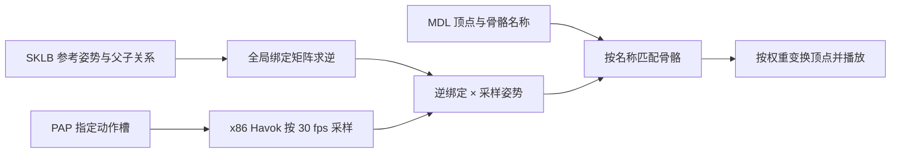

# 模型预览、骨架与动作

[知识库首页](README.md)

项目已完成 MDL 静态预览，以及通过本机 Godbert 的 x86 Havok 解码器采样怪物动作、按骨骼名称蒙皮的播放链路。当前实测覆盖三个怪物本体样本。完整游戏材质、人形角色装配和 FBX 动作导出仍属于后续工作。

本页整理 2026-11-13 对国服简中构建 `2026.11.03.0000.0000` 的验证，分别说明项目实现、上游实现和待扩展范围。模型名称与来源表见[模型目录](model-catalog.md)。

## 从 MDL 到可见网格

项目读取 LOD 0 主网格，按顶点声明定位坐标、法线、第一组 UV 和蒙皮数据。每个顶点属性按声明的流偏移、步长和元素类型解码。 [MDL 网格读取](../src/FFXIVPatchParser/LocalGameSource.Models.cs)

| 内容 | 当前处理 |
| --- | --- |
| 位置 | 支持 `Single3`、`Single4` 和 `Half4` |
| 三角面 | 读取 16 位索引，检查顶点范围和三角形完整性 |
| 法线与 UV | 读取受支持的浮点或半精度格式，使用 `UsageIndex == 0` 的属性 |
| 材质 | 保留每个网格的材质索引，解析 MTRL 引用 |
| 骨骼 | 读取骨骼名称和 mesh 的 bone palette，再解析每顶点索引及权重 |
| 预览上限 | 100 万顶点、200 万三角面，实时动作界面另限制为 10 万顶点 |

当前使用主网格，边缘几何等未支持布局会给出错误。后续如需复现更多角色外观，还要处理部位隐藏、形变和游戏中的装配规则。

### 材质定位与预览

程序根据模型根目录、材质名和已解析的材质变体定位 MTRL，并保留 shader package 名和纹理路径。部分装备共享人形皮肤材质，定位时也会检查相应的人形路径。 [材质与纹理读取](../src/FFXIVPatchParser/LocalGameSource.Models.Materials.cs)

当前显示 `_d.tex` 或 `_base.tex` 原始漫反射纹理。缺少独立漫反射纹理时显示灰模，法线、遮罩和高光贴图仍作为材质依赖记录。染色、colorset 和游戏 shader 的组合效果尚未实现。

USA蹦读出两个网格和两个材质，预览显示原始漫反射纹理。典雅方格阳伞读出一个网格和一个材质，IMC 子集 3 对应材质编号 3。该材质没有独立漫反射纹理，当前预览为灰模。

## 怪物 Idle 在共享 PAP 的槽里

怪物常见的待机与移动动作存于以下共享 PAP。

```text
chara/monster/mXXXX/animation/a0001/bt_common/resident/monster.pap
```

`cbnm_id0` 是优先使用的 Idle 槽名，找不到时尝试 `cbbm_id0`。仅拼接 `idle.pap`、`walk.pap` 会漏掉这个共享动作包。这个入口同时得到 [Godbert MonstersViewModel](https://github.com/xivapi/SaintCoinach/blob/master/Godbert/ViewModels/MonstersViewModel.cs) 和本地样本验证。

程序还从 `ActionTimeline` 字符串和常用动作名生成候选，再用索引确认路径存在。PAP 元数据读取器检查文件头、40 字节槽记录与 Havok 数据范围，取出槽名和槽索引。时长和姿势由 Havok 解码取得，播放前还要检查骨架兼容性。 [PAP 路径与槽读取](../src/FFXIVPatchParser/LocalGameSource.Animations.cs)

## 真正的动作采样链路



### 用 x86 进程调用 Havok

本机验证的 `hkAnimationInterop.dll`、`fbxInterop.dll` 和 `libfbxsdk.dll` 都是 I386 架构。直接在 x64 进程加载会产生 `BadImageFormatException`。Havok 桥接库还依赖 VC++ 2012 x86 运行库。

程序启动系统 32 位 PowerShell 子进程，从用户选定的 Godbert 安装目录加载 DLL，解析 SKLB 和 PAP 中的 Havok 数据，并以 30 fps 采样。每次调用单独保存临时输入和姿势输出。取消或超过 90 秒会终止子进程。 [Havok 采样入口](../src/FFXIVPatchParser/LocalGameSource.Havok.cs)

### 用逆绑定矩阵蒙皮

Havok 返回模型空间中的采样姿势。骨架参考姿势保存各骨骼相对父骨骼的局部变换。程序按以下顺序计算每帧的顶点位置。

1. 按行向量约定组成 `Scale × Rotation × Translation`。
2. 沿父骨骼链累乘参考姿势，得到全局绑定矩阵 `B`。
3. 对每帧采样姿势 `P(t)` 计算 `inverse(B) × P(t)`。
4. 顶点先通过 mesh bone palette 找到 MDL 骨骼，再按名称匹配解码骨架，按权重累加变换后的位置。

这一步使绑定姿势中的顶点正确进入动作姿势。MDL 与 SKLB 的骨骼数量和排列可能不同，按名称连接可以处理顺序变化。实现见 [Skinning.cs](../src/FFXIVPatchParser/LocalGameSource.Skinning.cs)，上游骨架与动画接口可参看 [Skeleton](https://github.com/xivapi/SaintCoinach/blob/master/SaintCoinach.Graphics.Viewer/Skeleton.cs)、[Animation](https://github.com/xivapi/SaintCoinach/blob/master/SaintCoinach.Graphics.Viewer/Animation.cs) 和 [AnimatedModel](https://github.com/xivapi/SaintCoinach/blob/master/SaintCoinach.Graphics.Viewer/AnimatedModel.cs)。

## 实测样本与目前覆盖

下表比较同一模型在 0 秒和 0.5 秒的蒙皮顶点位置。最大位移使用资源坐标单位，记录的是数值验证结果。

| 模型 | Idle 槽 | MDL / 骨架骨骼数 | 时长（秒） | 30 fps 采样帧数 | 发生变化的顶点 | 最大位移 |
| --- | --- | ---: | ---: | ---: | ---: | ---: |
| `m0001` | `cbnm_id0` | 35 / 46 | 2.3333333 | 70 | 2,973 / 2,973 | 0.02352756 |
| `m0002` | `cbbm_id0` | 32 / 35 | 2 | 60 | 514 / 514 | 0.0228054 |
| `m0003` | `cbnm_id0` | 35 / 40 | 2.6666667 | 81 | 1,466 / 1,466 | 0.017085155 |

`m0003` 的 81 帧来自当前 `ceil(duration × 30)` 的浮点计算结果。单独的蒙皮检查还验证了骨骼名称重排、加权平移、单位绑定姿势，并确认缺失骨骼和模型不匹配会被拒绝。顶点发生变化证明采样结果进入了网格，画面正确性还需结合视口观察。

| 范围 | 当前状态 |
| --- | --- |
| 模型和 PAP | 怪物本体路径，PAP 必须属于同一 monster ID |
| 骨架路径 | 当前固定读取该怪物 `skeleton/base/b0001` |
| SKLB 版本 | 代码接受 `0021`、`0031`、`0032`，本地样本实际覆盖前两种 |
| 权重 | 四个字节骨骼索引与四个字节归一化权重，八权重布局待支持 |
| 骨骼兼容性 | 所有被顶点引用的骨骼都需按名称匹配，未绑定顶点会报错 |
| 资源上限 | 动作最多 120 秒、1,024 根骨骼、100 万骨骼帧 |
| 播放 | 采样后更新顶点位置，界面实现见 [ModelPreview.Playback](../src/FFXIVPatchParser.Desktop/ModelPreview.Playback.cs) |
| 游戏行为 | 当前播放指定片段，动作混合、状态机、特效同步等待扩展 |

## Godbert 的 FBX 导出

Godbert 的导出代码把 LOD 0 网格、骨架和收集到的 PAP 一起传给 `FbxExport.ExportFbx`，同时导出对应材质。这条上游实现提供了后续接入的参考，见 [MonstersViewModel](https://github.com/xivapi/SaintCoinach/blob/master/Godbert/ViewModels/MonstersViewModel.cs) 和 [FbxExport](https://github.com/xivapi/SaintCoinach/blob/master/SaintCoinach.Graphics.Viewer/Interop/FbxExport.cs)。

本项目要接入 FBX 导出，还需把网格、骨架和动作传给原生导出器，验证 FBX SDK 依赖和导出文件中的动画轨道。

## 复现动作播放

1. 记录客户端构建和语言，选定完整 MDL 路径，读取静态预览并检查材质警告。
2. 调用 `ListModelAnimationPaths`，读取 `monster.pap` 槽表，优先选 `cbnm_id0`，其次 `cbbm_id0`。
3. 使用本机 Godbert 调用 `BakeModelAnimationAsync`，记录骨骼数量、时长和帧数。
4. 调用 `SkinModelFrame` 对照 0 秒与 0.5 秒的顶点，再在视口检查播放和停止行为。
5. 增加新模型族、SKLB 版本或权重布局时，分别记录“找到资源”“解码成功”“蒙皮正确”“画面验证”的结果。
